# AI GameDev Atlas

Atlas visual de referências para criar jogos **2D com IA**: ferramentas, pacotes de pixel art, geradores e um glossário animado de 34 conceitos de game dev com _prompt bits_ prontos para colar no seu assistente de código.

> Curadoria pessoal de [stefanoferrao](https://github.com/stefanoferrao). Reúne os itens da lista de stars [2D - IA Game Design](https://github.com/stars/stefanoferrao/lists/2d-ia-game-design) e o [Game Dev Cheat Sheet](https://gamedev-cheatsheet.com/).

## Sumário

- [Ferramentas e assets](#ferramentas-e-assets)
  - [pixelfx — 244 efeitos de pixel art em código](#pixelfx)
  - [SpriteFusion Sprite Normals — normal maps para sprites](#spritefusion-sprite-normals)
  - [Pixel Planets (Godot 4) — gerador de planetas](#pixel-planets-godot-4)
  - [PixelSRPG-Forge — pacote de assets SRPG](#pixelsrpg-forge)
- [Game Dev Cheat Sheet — 34 conceitos animados](#game-dev-cheat-sheet)
- [Créditos e licenças](#créditos-e-licenças)

---

## Ferramentas e assets

### pixelfx

**[patch-gg/pixelfx](https://github.com/patch-gg/pixelfx)** · JavaScript · MIT

244 efeitos de pixel art, cada um um pequeno trecho de código, e uma skill do Claude Code para criar os seus. Bom ponto de partida para VFX procedural (fogo, água, portais, magia) sem spritesheet.

| Campfire | Waterfall | Plasma ball |
|:---:|:---:|:---:|
|  |  | 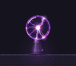 |
| **Portal** | **Black hole** | **Tornado** |
| 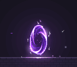 | 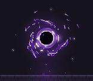 | 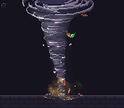 |

Animações de combate (knight vs. dummy):

### SpriteFusion Sprite Normals

**[Hugo-Dz/spritefusion-sprite-normals](https://github.com/Hugo-Dz/spritefusion-sprite-normals)** · Rust · MIT

Gera normal maps a partir de qualquer sprite ou spritesheet animado. Com o normal map, a engine ilumina pixel art 2D com luzes dinâmicas (ver [Normals](gamedev-cheatsheet/normals.md)).

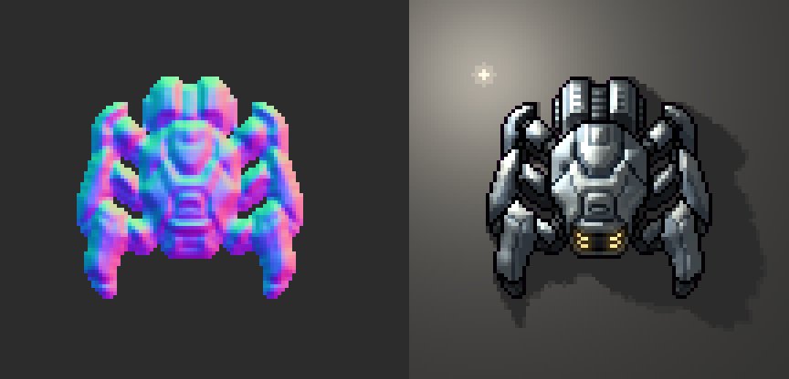

### Pixel Planets (Godot 4)

**[jacob-winkler/pixel-planets-godot4](https://github.com/jacob-winkler/pixel-planets-godot4)** · GDScript · MIT (branch `migrate-to-godot-4`)

Port para Godot 4 do [Pixel Planet Generator](https://deep-fold.itch.io/pixel-planet-generator) de Deep-Fold ([código original](https://github.com/Deep-Fold/PixelPlanets)). Planetas, luas, gigantes gasosos, anéis e estrelas em pixel art, todos via shaders com seed, cores e resolução configuráveis.

| Terran (wet) | Ocean islands | Ice world |
|:---:|:---:|:---:|
|  | 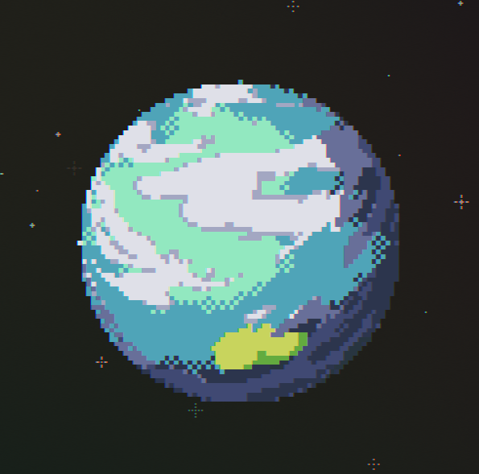 | 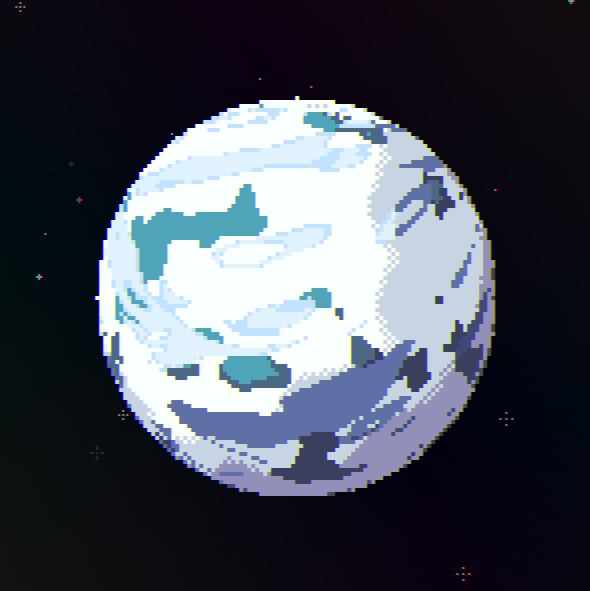 |
| **Ringed gas giant** | **Lava / dry** | **Terran** |
|  | 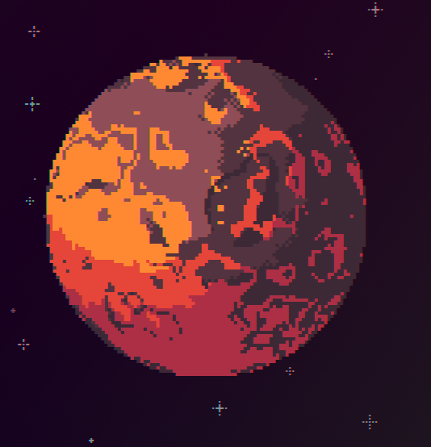 | 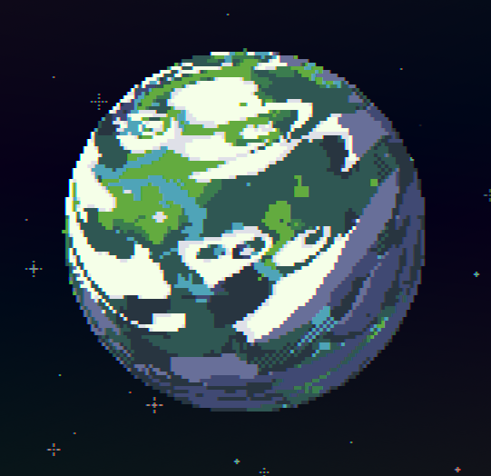 |

Gerador em ação (port Unity [hmcGit/UniPixelPlanet](https://github.com/hmcGit/UniPixelPlanet), mesmos shaders):

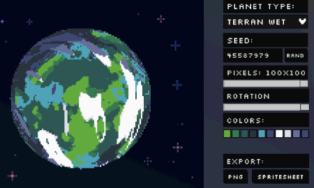

### PixelSRPG-Forge

**[Huu-Yuu/PixelSRPG-Forge](https://github.com/Huu-Yuu/PixelSRPG-Forge)** · MIT (declarada pelo repo)

Coleção de assets pixel art para SRPG: personagens, construções, terreno, interiores, UI, ícones, efeitos e sons. Compatível com SRPG Studio, Godot e Unity.

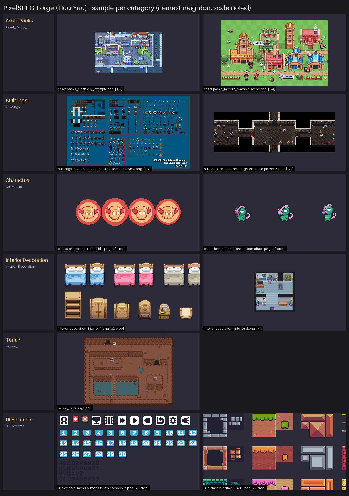

| Clean City | FarmLife | Pixel Dungeon |
|:---:|:---:|:---:|
|  |  | 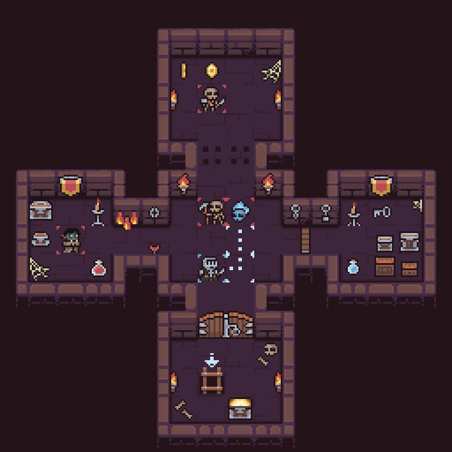 |
| **Sandstone Dungeons (preview)** | **Sandstone Dungeons (build)** | **Sandstone characters** |
| 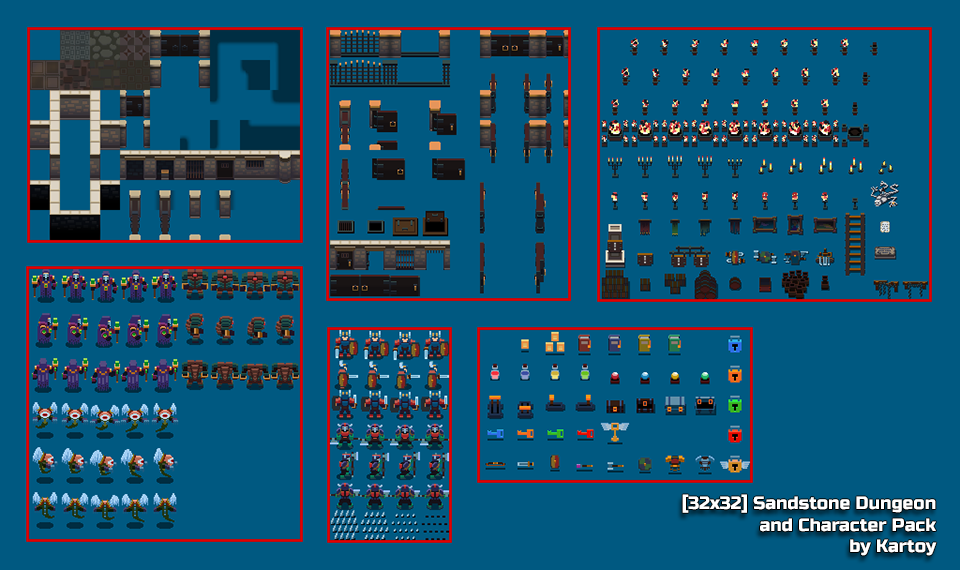 | 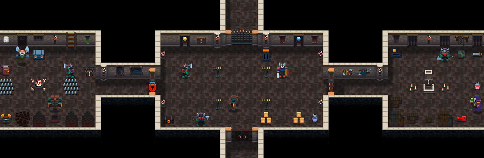 |  |

> ⚠️ Parte do conteúdo parece ser arte de terceiros redistribuída (ex.: Sandstone Dungeons by Kartoy, Pixel Adventure by Pixel Frog). Confira a licença de origem antes de usar comercialmente. Ícones MapleStory (Nexon) e o pacote de 31k ícones de revendedor foram deliberadamente **excluídos** desta curadoria.

---

## Game Dev Cheat Sheet

34 conceitos de game dev, cada um com demo animada, explicação curta e um **prompt bit**: uma frase pronta para colar no prompt da IA e obter o comportamento certo. Organizados em 4 capítulos: 3D & rendering, Game feel, Systems e Performance.

➡️ **[Índice completo com miniaturas](gamedev-cheatsheet/README.md)**

### 3D & rendering

<table>
<tr>
<td align="center" width="25%"> <b>01. Raycasting</b> ask a line what it hits</td>
<td align="center" width="25%"> <b>02. Normals</b> which way a surface faces</td>
<td align="center" width="25%"> <b>03. Level of detail</b> cheap mesh when it is far</td>
<td align="center" width="25%"> <b>04. Frustum culling</b> skip what the camera cannot see</td>
</tr>
<tr>
<td align="center" width="25%"><a href="gamedev-cheatsheet/fragment-shader.md">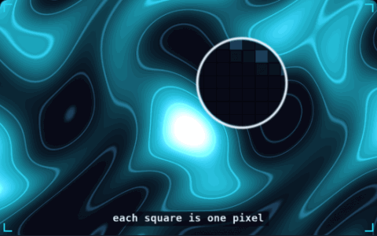</a> <b>05. Fragment shader</b> a tiny program per pixel</td>
<td align="center" width="25%"> <b>06. Billboarding</b> always turn to face the camera</td>
<td align="center" width="25%"> <b>07. Quaternions</b> rotations that take the short way</td>
<td align="center" width="25%"> <b>08. Z-fighting</b> two surfaces fighting for pixels</td>
</tr>
</table>

### Game feel

<table>
<tr>
<td align="center" width="25%"> <b>09. Delta time</b> move per second, not per frame</td>
<td align="center" width="25%"><a href="gamedev-cheatsheet/coyote-time.md">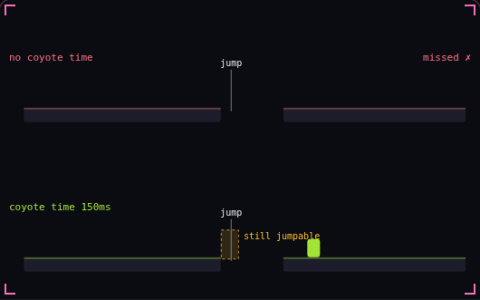</a> <b>10. Coyote time</b> a late jump that still counts</td>
<td align="center" width="25%"> <b>11. Easing</b> bend linear motion into curves</td>
<td align="center" width="25%"><a href="gamedev-cheatsheet/screen-shake.md">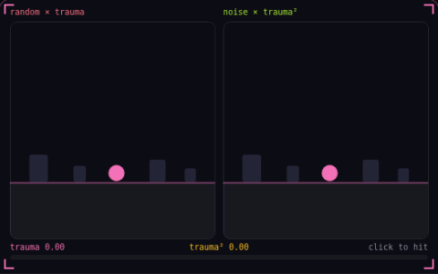</a> <b>12. Screen shake</b> one trauma value drives the shake</td>
</tr>
<tr>
<td align="center" width="25%"><a href="gamedev-cheatsheet/squash-and-stretch.md">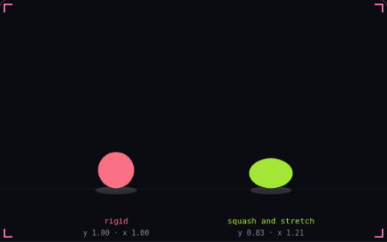</a> <b>13. Squash and stretch</b> shape shows speed and impact</td>
<td align="center" width="25%"> <b>14. Camera deadzone</b> let the player move first</td>
<td align="center" width="25%"> <b>15. Input buffering</b> an early press that still counts</td>
<td align="center" width="25%"> <b>16. Acceleration and friction</b> speed builds up and bleeds off</td>
</tr>
<tr>
<td align="center" width="25%"> <b>17. Hit stop</b> freeze both fighters on impact</td>
<td align="center" width="25%"><a href="gamedev-cheatsheet/invincibility-frames.md">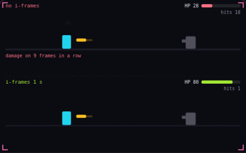</a> <b>18. Invincibility frames</b> brief safety after each hit</td>
</tr>
</table>

### Systems

<table>
<tr>
<td align="center" width="25%"><a href="gamedev-cheatsheet/object-pooling.md">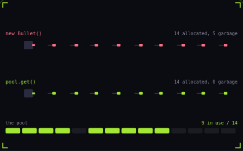</a> <b>19. Object pooling</b> allocate once, reuse forever</td>
<td align="center" width="25%"><a href="gamedev-cheatsheet/state-machine.md">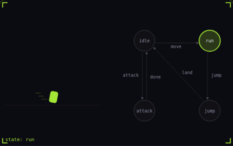</a> <b>20. Finite state machine</b> one state at a time</td>
<td align="center" width="25%"> <b>21. Hitbox and hurtbox</b> what hits, what gets hit</td>
<td align="center" width="25%"> <b>22. A* pathfinding</b> search that aims at the goal</td>
</tr>
<tr>
<td align="center" width="25%"> <b>23. Particle system</b> one emitter, many short lives</td>
<td align="center" width="25%"> <b>24. Fixed timestep</b> physics on a steady clock</td>
<td align="center" width="25%"><a href="gamedev-cheatsheet/steering-behaviors.md">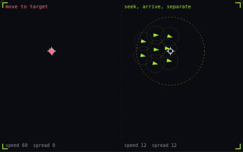</a> <b>25. Steering behaviors</b> nudge velocity toward a goal</td>
<td align="center" width="25%"> <b>26. Tunneling</b> fast objects skip through walls</td>
</tr>
<tr>
<td align="center" width="25%"><a href="gamedev-cheatsheet/seeded-noise.md">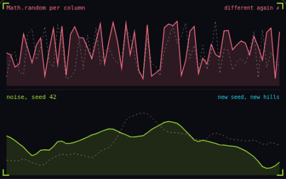</a> <b>27. Seeded noise</b> same seed, same world</td>
</tr>
</table>

### Performance

<table>
<tr>
<td align="center" width="25%"> <b>28. Frame budget</b> 16.67 ms, and where it goes</td>
<td align="center" width="25%"><a href="gamedev-cheatsheet/draw-calls.md">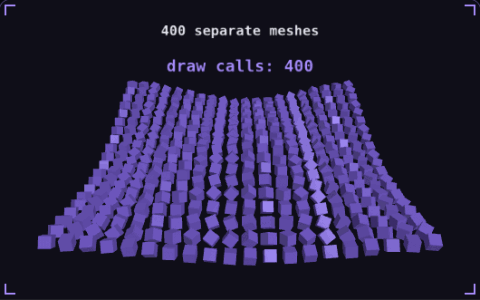</a> <b>29. Draw calls</b> one call, four hundred crates</td>
<td align="center" width="25%"> <b>30. Spatial partitioning</b> only test what is nearby</td>
<td align="center" width="25%"> <b>31. Overdraw</b> the same pixel, shaded again</td>
</tr>
<tr>
<td align="center" width="25%"> <b>32. Time slicing</b> spread the work across frames</td>
<td align="center" width="25%"><a href="gamedev-cheatsheet/texture-atlas.md">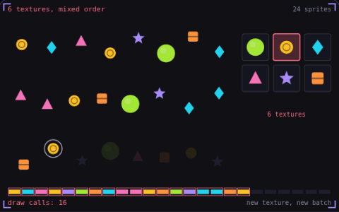</a> <b>33. Texture atlas</b> one texture, one draw call</td>
<td align="center" width="25%"><a href="gamedev-cheatsheet/chunk-streaming.md">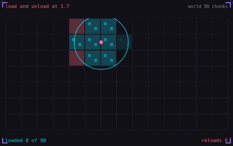</a> <b>34. Chunk streaming</b> load only what is near the player</td>
</tr>
</table>

---

## Créditos e licenças

- Cada repositório citado pertence a seus autores e segue a própria licença (todos declaram MIT). Imagens em [`assets/`](assets/) vêm dos READMEs, do próprio repo ou da página itch.io do projeto; origem de cada arquivo em [`assets/SOURCES.md`](assets/SOURCES.md).
- Screenshots do Pixel Planet Generator vêm de [deep-fold.itch.io](https://deep-fold.itch.io/pixel-planet-generator), sem licença declarada para as imagens.
- O conteúdo de [`gamedev-cheatsheet/`](gamedev-cheatsheet/) (textos, prompt bits e capturas das demos) é de **Nicolas Zullo** ([gamedev-cheatsheet.com](https://gamedev-cheatsheet.com/), [@NicolasZu](https://x.com/NicolasZu)), espelhado aqui para referência pessoal. O site não declara licença: peça permissão ao autor antes de tornar este repositório público.
