# AI GameDev Atlas

Atlas visual de referências para criar jogos **2D com IA**: ferramentas, pacotes de pixel art, geradores, 134 projetos do Pixel Composer e um glossário animado de 34 conceitos de game dev com _prompt bits_ prontos para colar no seu assistente de código.

> Curadoria pessoal de [stefanoferrao](https://github.com/stefanoferrao). Reúne os itens da lista de stars [2D - IA Game Design](https://github.com/stars/stefanoferrao/lists/2d-ia-game-design) , os [showcases do Pixel Composer](https://pixel-composer.com/showcases.html) e o [Game Dev Cheat Sheet](https://gamedev-cheatsheet.com/).

## Sumário

- [Estrutura](#estrutura)
- [Como usar](#como-usar)
- [Ferramentas e assets](#ferramentas-e-assets)
  - [pixelfx — 244 efeitos de pixel art em código](#pixelfx)
  - [SpriteFusion Sprite Normals — normal maps para sprites](#spritefusion-sprite-normals)
  - [Pixel Planets (Godot 4) — gerador de planetas](#pixel-planets-godot-4)
  - [PixelSRPG-Forge — pacote de assets SRPG](#pixelsrpg-forge)
- [Pixel Composer — 134 projetos de VFX e pixel art](#pixel-composer)
- [Game Dev Cheat Sheet — 34 conceitos animados](#game-dev-cheat-sheet)
- [Créditos e licenças](#créditos-e-licenças)

---

## Estrutura

Tudo fica dentro deste repositório: código, assets e demos. Não depende dos repositórios de origem nem do site.

```
ai-gamedev-atlas/
├── repos/                         # código/conteúdo completo de cada repo (vendorizado)
│   ├── pixelfx/                   #   efeitos JS + skill do Claude Code (skills/pixelfx)
│   ├── spritefusion-sprite-normals/  # CLI Rust de normal maps
│   ├── pixel-planets-godot4/      #   projeto Godot 4 com shaders de planetas
│   └── PixelSRPG-Forge/           #   assets pixel art, zips já extraídos
├── pixel-composer/
│   ├── README.md                  # galeria dos 134 projetos
│   ├── projects/<Projeto>/        # arquivo .pxc + miniaturas originais
│   └── media/                     # miniaturas ampliadas 4× + contact sheet
├── gamedev-cheatsheet/
│   ├── README.md                  # índice dos 34 conceitos
│   ├── <conceito>.md              # texto, prompt bit, pseudocódigo, erros comuns
│   ├── media/                     # GIF + PNG de cada demo
│   └── site/                      # espelho offline do site (demos interativas)
├── previews/                      # imagens deste README + SOURCES.md
├── scripts/
│   ├── serve.sh                   # sobe cheatsheet ou galeria pixelfx localmente
│   ├── update-vendor.sh           # atualiza repos/ a partir do upstream
│   ├── pxc_previews.py            # regenera mídia do Pixel Composer
│   └── unzip_safe.py
├── VENDORED.md                    # origem, commit e licença de cada cópia
└── CHANGELOG.md                   # notas de atualização (releases)
```

## Como usar

| Quero... | Faça |
|---|---|
| Colar um conceito no prompt da IA | Abra `gamedev-cheatsheet/<conceito>.md` e copie o bloco **Prompt bit** |
| Ver as demos interativas offline | `scripts/serve.sh cheatsheet` e abra <http://127.0.0.1:8765> |
| Ver/editar os efeitos do pixelfx | `scripts/serve.sh pixelfx` (Node 18+) |
| Instalar a skill pixelfx no Claude Code | `cp -r repos/pixelfx/skills/pixelfx ~/.claude/skills/` |
| Usar os efeitos num jogo web | copie `repos/pixelfx/src/core` e os efeitos de `repos/pixelfx/src/fx` |
| Gerar normal map de um sprite | `cd repos/spritefusion-sprite-normals && cargo install --path . --locked` (ver README do repo) |
| Usar planetas no Godot 4 | abra `repos/pixel-planets-godot4/project.godot` no Godot 4 |
| Usar assets de SRPG | arraste as pastas de `repos/PixelSRPG-Forge/` para o projeto (Godot, Unity, SRPG Studio) |
| Estudar/remixar um VFX em nós | abra `pixel-composer/projects/<Projeto>/*.pxc` no [Pixel Composer](https://pixel-composer.com/) |
| Atualizar tudo do upstream | `scripts/update-vendor.sh` (ou `scripts/update-vendor.sh pixelfx`) e revise o `git diff` |

---

## Ferramentas e assets

### pixelfx

📁 **Local: [`repos/pixelfx/`](repos/pixelfx/)** · origem [patch-gg/pixelfx](https://github.com/patch-gg/pixelfx) · JavaScript · MIT

244 efeitos de pixel art, cada um um pequeno trecho de código, e uma skill do Claude Code para criar os seus. Bom ponto de partida para VFX procedural (fogo, água, portais, magia) sem spritesheet.

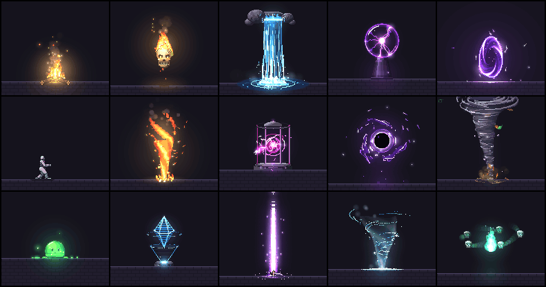

| Campfire | Waterfall | Plasma ball |
|:---:|:---:|:---:|
| 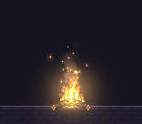 | 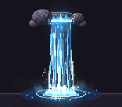 |  |
| **Portal** | **Black hole** | **Tornado** |
|  |  |  |

Animações de combate (knight vs. dummy):

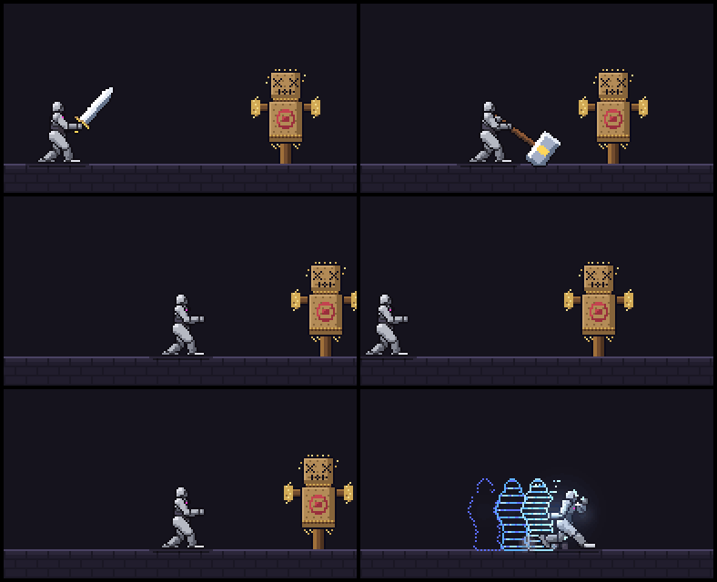

### SpriteFusion Sprite Normals

📁 **Local: [`repos/spritefusion-sprite-normals/`](repos/spritefusion-sprite-normals/)** · origem [Hugo-Dz/spritefusion-sprite-normals](https://github.com/Hugo-Dz/spritefusion-sprite-normals) · Rust · MIT

Gera normal maps a partir de qualquer sprite ou spritesheet animado. Com o normal map, a engine ilumina pixel art 2D com luzes dinâmicas (ver [Normals](gamedev-cheatsheet/normals.md)).


### Pixel Planets (Godot 4)

📁 **Local: [`repos/pixel-planets-godot4/`](repos/pixel-planets-godot4/)** · origem [jacob-winkler/pixel-planets-godot4](https://github.com/jacob-winkler/pixel-planets-godot4) · GDScript · MIT (branch `migrate-to-godot-4`)

Port para Godot 4 do [Pixel Planet Generator](https://deep-fold.itch.io/pixel-planet-generator) de Deep-Fold ([código original](https://github.com/Deep-Fold/PixelPlanets)). Planetas, luas, gigantes gasosos, anéis e estrelas em pixel art, todos via shaders com seed, cores e resolução configuráveis.

| Terran (wet) | Ocean islands | Ice world |
|:---:|:---:|:---:|
| 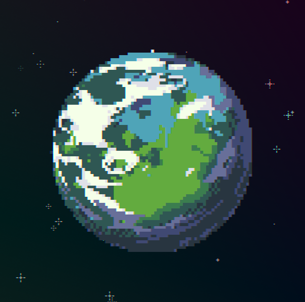 |  |  |
| **Ringed gas giant** | **Lava / dry** | **Terran** |
| 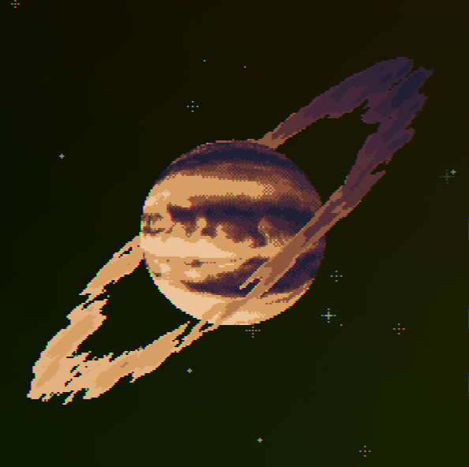 |  |  |

Gerador em ação (port Unity [hmcGit/UniPixelPlanet](https://github.com/hmcGit/UniPixelPlanet), mesmos shaders):


### PixelSRPG-Forge

📁 **Local: [`repos/PixelSRPG-Forge/`](repos/PixelSRPG-Forge/)** · origem [Huu-Yuu/PixelSRPG-Forge](https://github.com/Huu-Yuu/PixelSRPG-Forge) · MIT (declarada pelo repo)

Coleção de assets pixel art para SRPG: personagens, construções, terreno, interiores, UI, ícones, efeitos e sons. Compatível com SRPG Studio, Godot e Unity.


| Clean City | FarmLife | Pixel Dungeon |
|:---:|:---:|:---:|
| 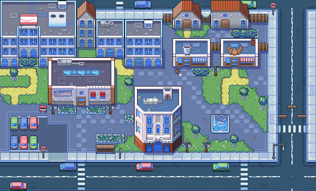 | 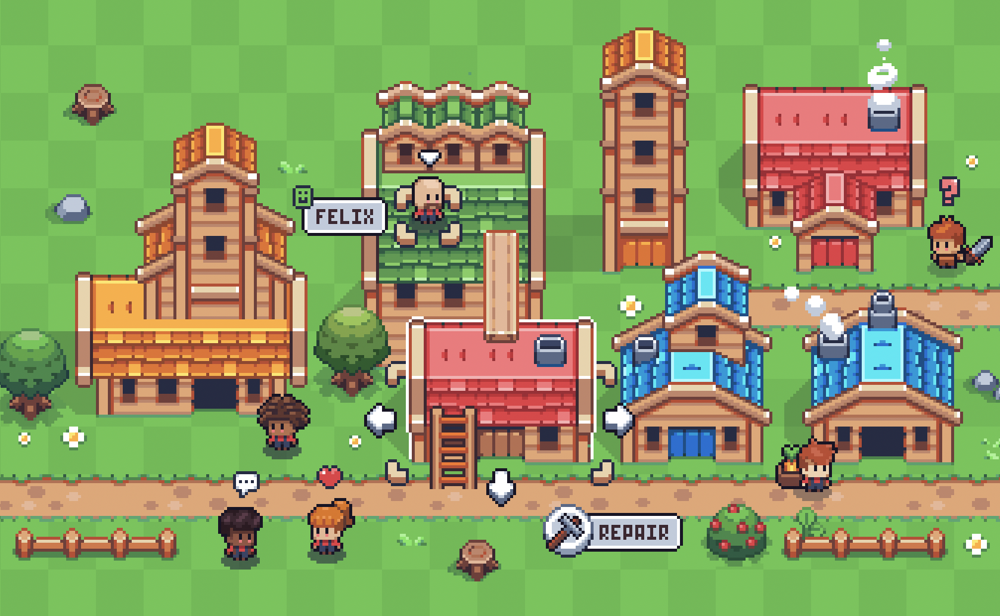 |  |
| **Sandstone Dungeons (preview)** | **Sandstone Dungeons (build)** | **Sandstone characters** |
|  |  | 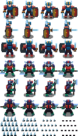 |

> ⚠️ Parte do conteúdo parece ser arte de terceiros redistribuída (ex.: Sandstone Dungeons by Kartoy, Pixel Adventure by Pixel Frog). Confira a licença de origem antes de usar comercialmente. Ícones MapleStory (Nexon) e o pacote de 31k ícones de revendedor foram deliberadamente **excluídos** desta curadoria (ver [VENDORED.md](VENDORED.md)).

---

## Pixel Composer

📁 **Local: [`pixel-composer/`](pixel-composer/)** · origem [pixel-composer.com/showcases](https://pixel-composer.com/showcases.html) · app [Ttanasart-pt/Pixel-Composer](https://github.com/Ttanasart-pt/Pixel-Composer) (MIT)

[Pixel Composer](https://pixel-composer.com/) é um editor **node-based** de VFX e pixel art de MakhamDev. Os 134 projetos oficiais estão aqui com o arquivo **`.pxc`** (o grafo completo, pronto para abrir e remixar) e as miniaturas. É uma ótima biblioteca de receitas de fogo, magia, água, portais, cenários e itens.

<table><tr><td align="center">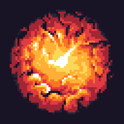<br><sub>Spiral Fireball</sub></td><td align="center">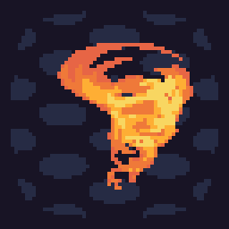<br><sub>Fire Tornado</sub></td><td align="center">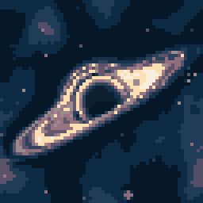<br><sub>Black Hole</sub></td><td align="center">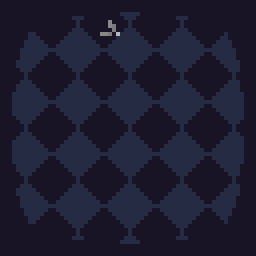<br><sub>Spark Bolt</sub></td><td align="center">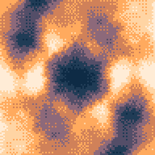<br><sub>Portal Cream</sub></td><td align="center">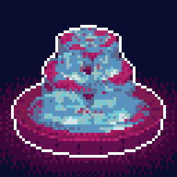<br><sub>Fountain</sub></td></tr><tr><td align="center">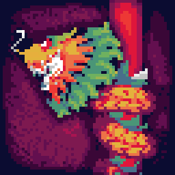<br><sub>Dragon</sub></td><td align="center">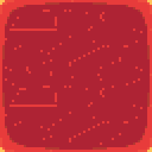<br><sub>Lava Floor</sub></td><td align="center">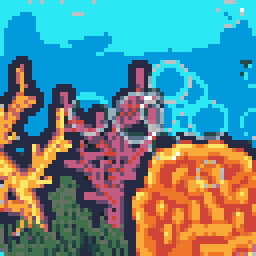<br><sub>Coral Reef</sub></td><td align="center">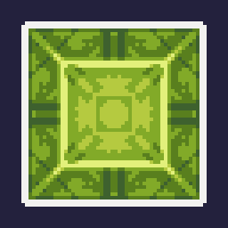<br><sub>Morphing Gem</sub></td><td align="center">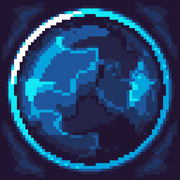<br><sub>Underwater View</sub></td><td align="center">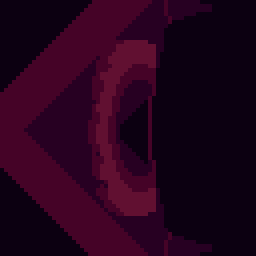<br><sub>Rocket Thrust</sub></td></tr></table>

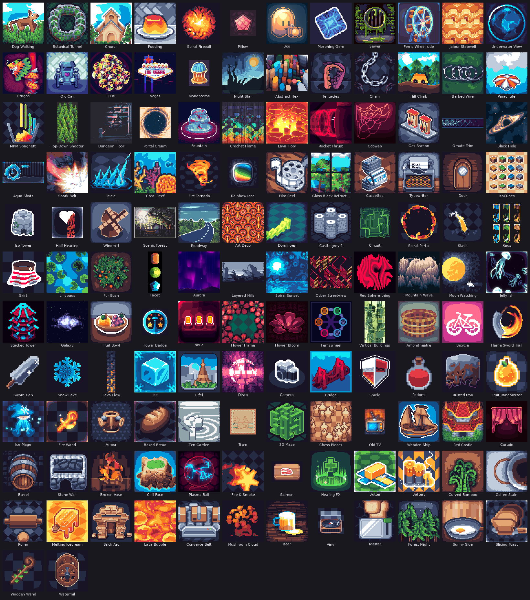

➡️ **[Galeria completa com links para cada .pxc](pixel-composer/README.md)**

---

## Game Dev Cheat Sheet

34 conceitos de game dev, cada um com demo animada, explicação curta e um **prompt bit**: uma frase pronta para colar no prompt da IA e obter o comportamento certo. Organizados em 4 capítulos: 3D & rendering, Game feel, Systems e Performance.

➡️ **[Índice completo com miniaturas](gamedev-cheatsheet/README.md)** · demos interativas offline: `scripts/serve.sh cheatsheet`

### 3D & rendering

<table>
<tr>
<td align="center" width="25%"><a href="gamedev-cheatsheet/raycasting.md">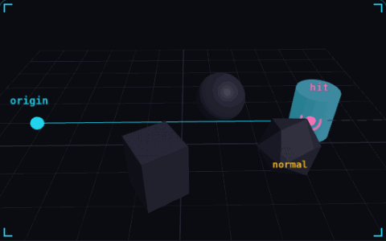</a><br><b>01. Raycasting</b><br><sub>ask a line what it hits</sub></td>
<td align="center" width="25%"><a href="gamedev-cheatsheet/normals.md">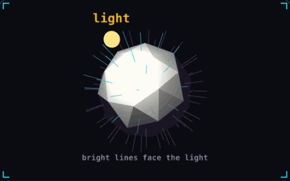</a><br><b>02. Normals</b><br><sub>which way a surface faces</sub></td>
<td align="center" width="25%"><a href="gamedev-cheatsheet/level-of-detail.md">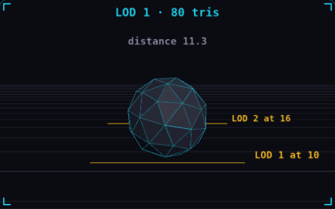</a><br><b>03. Level of detail</b><br><sub>cheap mesh when it is far</sub></td>
<td align="center" width="25%"><a href="gamedev-cheatsheet/frustum-culling.md">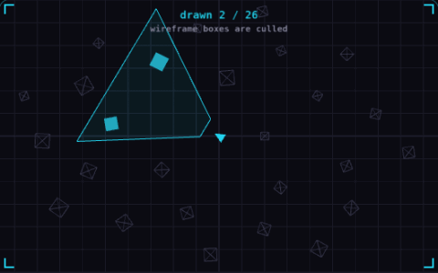</a><br><b>04. Frustum culling</b><br><sub>skip what the camera cannot see</sub></td>
</tr>
<tr>
<td align="center" width="25%"><a href="gamedev-cheatsheet/fragment-shader.md"></a><br><b>05. Fragment shader</b><br><sub>a tiny program per pixel</sub></td>
<td align="center" width="25%"><a href="gamedev-cheatsheet/billboarding.md">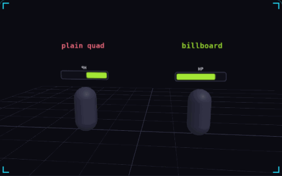</a><br><b>06. Billboarding</b><br><sub>always turn to face the camera</sub></td>
<td align="center" width="25%"><a href="gamedev-cheatsheet/quaternions.md">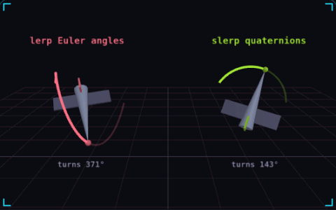</a><br><b>07. Quaternions</b><br><sub>rotations that take the short way</sub></td>
<td align="center" width="25%"><a href="gamedev-cheatsheet/z-fighting.md">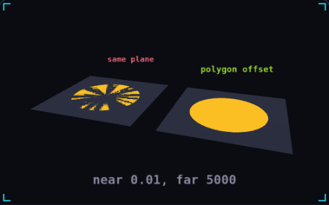</a><br><b>08. Z-fighting</b><br><sub>two surfaces fighting for pixels</sub></td>
</tr>
</table>

### Game feel

<table>
<tr>
<td align="center" width="25%"><a href="gamedev-cheatsheet/delta-time.md">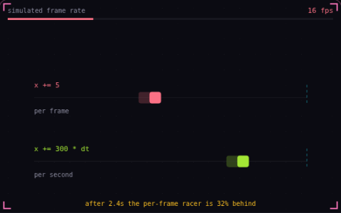</a><br><b>09. Delta time</b><br><sub>move per second, not per frame</sub></td>
<td align="center" width="25%"><a href="gamedev-cheatsheet/coyote-time.md"></a><br><b>10. Coyote time</b><br><sub>a late jump that still counts</sub></td>
<td align="center" width="25%"><a href="gamedev-cheatsheet/easing.md">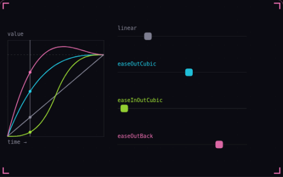</a><br><b>11. Easing</b><br><sub>bend linear motion into curves</sub></td>
<td align="center" width="25%"><a href="gamedev-cheatsheet/screen-shake.md"></a><br><b>12. Screen shake</b><br><sub>one trauma value drives the shake</sub></td>
</tr>
<tr>
<td align="center" width="25%"><a href="gamedev-cheatsheet/squash-and-stretch.md"></a><br><b>13. Squash and stretch</b><br><sub>shape shows speed and impact</sub></td>
<td align="center" width="25%"><a href="gamedev-cheatsheet/camera-deadzone.md">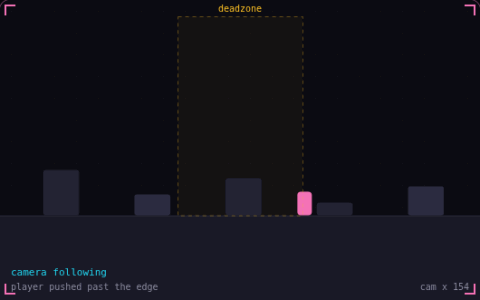</a><br><b>14. Camera deadzone</b><br><sub>let the player move first</sub></td>
<td align="center" width="25%"><a href="gamedev-cheatsheet/input-buffering.md">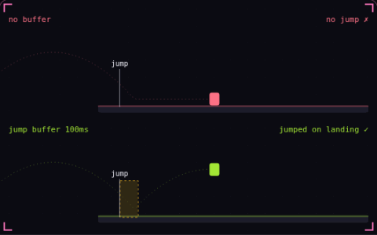</a><br><b>15. Input buffering</b><br><sub>an early press that still counts</sub></td>
<td align="center" width="25%"><a href="gamedev-cheatsheet/acceleration-and-friction.md">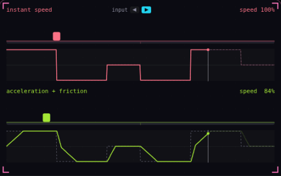</a><br><b>16. Acceleration and friction</b><br><sub>speed builds up and bleeds off</sub></td>
</tr>
<tr>
<td align="center" width="25%"><a href="gamedev-cheatsheet/hit-stop.md">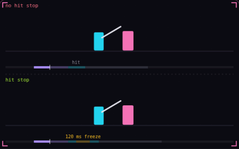</a><br><b>17. Hit stop</b><br><sub>freeze both fighters on impact</sub></td>
<td align="center" width="25%"><a href="gamedev-cheatsheet/invincibility-frames.md"></a><br><b>18. Invincibility frames</b><br><sub>brief safety after each hit</sub></td>
</tr>
</table>

### Systems

<table>
<tr>
<td align="center" width="25%"><a href="gamedev-cheatsheet/object-pooling.md"></a><br><b>19. Object pooling</b><br><sub>allocate once, reuse forever</sub></td>
<td align="center" width="25%"><a href="gamedev-cheatsheet/state-machine.md"></a><br><b>20. Finite state machine</b><br><sub>one state at a time</sub></td>
<td align="center" width="25%"><a href="gamedev-cheatsheet/hitbox-hurtbox.md">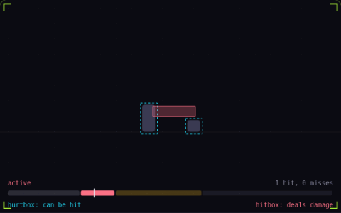</a><br><b>21. Hitbox and hurtbox</b><br><sub>what hits, what gets hit</sub></td>
<td align="center" width="25%"><a href="gamedev-cheatsheet/pathfinding.md">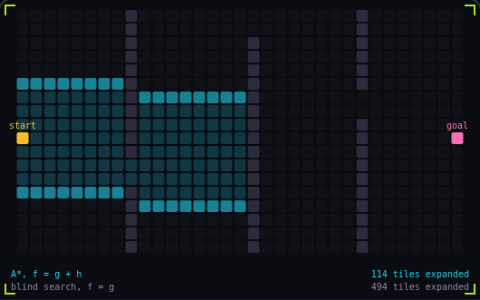</a><br><b>22. A* pathfinding</b><br><sub>search that aims at the goal</sub></td>
</tr>
<tr>
<td align="center" width="25%"><a href="gamedev-cheatsheet/particle-system.md">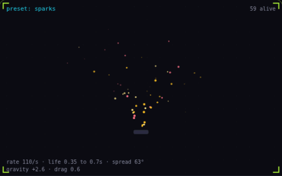</a><br><b>23. Particle system</b><br><sub>one emitter, many short lives</sub></td>
<td align="center" width="25%"><a href="gamedev-cheatsheet/fixed-timestep.md">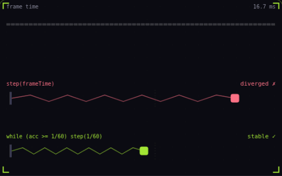</a><br><b>24. Fixed timestep</b><br><sub>physics on a steady clock</sub></td>
<td align="center" width="25%"><a href="gamedev-cheatsheet/steering-behaviors.md"></a><br><b>25. Steering behaviors</b><br><sub>nudge velocity toward a goal</sub></td>
<td align="center" width="25%"><a href="gamedev-cheatsheet/tunneling.md">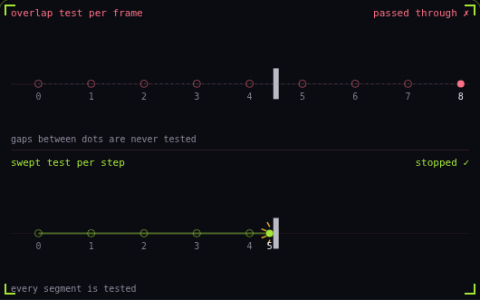</a><br><b>26. Tunneling</b><br><sub>fast objects skip through walls</sub></td>
</tr>
<tr>
<td align="center" width="25%"><a href="gamedev-cheatsheet/seeded-noise.md"></a><br><b>27. Seeded noise</b><br><sub>same seed, same world</sub></td>
</tr>
</table>

### Performance

<table>
<tr>
<td align="center" width="25%"><a href="gamedev-cheatsheet/frame-budget.md">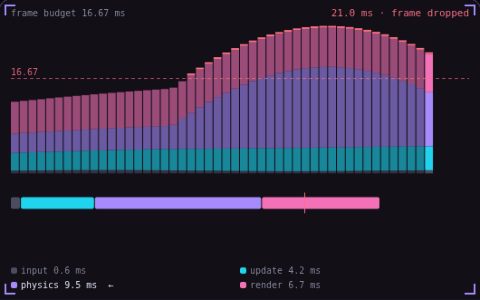</a><br><b>28. Frame budget</b><br><sub>16.67 ms, and where it goes</sub></td>
<td align="center" width="25%"><a href="gamedev-cheatsheet/draw-calls.md"></a><br><b>29. Draw calls</b><br><sub>one call, four hundred crates</sub></td>
<td align="center" width="25%"><a href="gamedev-cheatsheet/spatial-partitioning.md">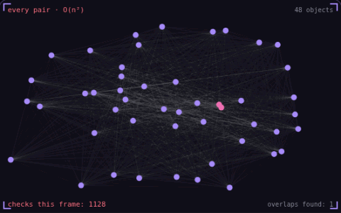</a><br><b>30. Spatial partitioning</b><br><sub>only test what is nearby</sub></td>
<td align="center" width="25%"><a href="gamedev-cheatsheet/overdraw.md">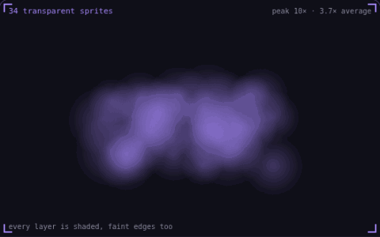</a><br><b>31. Overdraw</b><br><sub>the same pixel, shaded again</sub></td>
</tr>
<tr>
<td align="center" width="25%"><a href="gamedev-cheatsheet/time-slicing.md">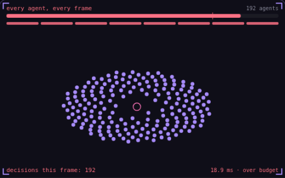</a><br><b>32. Time slicing</b><br><sub>spread the work across frames</sub></td>
<td align="center" width="25%"><a href="gamedev-cheatsheet/texture-atlas.md"></a><br><b>33. Texture atlas</b><br><sub>one texture, one draw call</sub></td>
<td align="center" width="25%"><a href="gamedev-cheatsheet/chunk-streaming.md"></a><br><b>34. Chunk streaming</b><br><sub>load only what is near the player</sub></td>
</tr>
</table>

---

## Créditos e licenças

- Origem, commit fixado e alterações de cada cópia em [`VENDORED.md`](VENDORED.md). Cada pasta em `repos/` mantém o `LICENSE` original.
- Cada repositório citado pertence a seus autores e segue a própria licença (todos declaram MIT). Imagens em [`previews/`](previews/) vêm dos READMEs, do próprio repo ou da página itch.io do projeto; origem de cada arquivo em [`previews/SOURCES.md`](previews/SOURCES.md).
- Screenshots do Pixel Planet Generator vêm de [deep-fold.itch.io](https://deep-fold.itch.io/pixel-planet-generator), sem licença declarada para as imagens.
- Projetos e miniaturas em [`pixel-composer/`](pixel-composer/) são de **MakhamDev** ([pixel-composer.com](https://pixel-composer.com/)), distribuídos gratuitamente no site e sem licença declarada para os `.pxc`. O app Pixel Composer é MIT.
- O conteúdo de [`gamedev-cheatsheet/`](gamedev-cheatsheet/) (textos, prompt bits e capturas das demos) é de **Nicolas Zullo** ([gamedev-cheatsheet.com](https://gamedev-cheatsheet.com/), [@NicolasZu](https://x.com/NicolasZu)), espelhado aqui para referência pessoal. O site não declara licença: peça permissão ao autor antes de tornar este repositório público.
