# Game Dev Cheat Sheet — 34 conceitos

Espelho em markdown de <https://gamedev-cheatsheet.com/> (Nicolas Zullo). Cada conceito traz descrição, _prompt bit_ para colar no prompt da IA, quando usar, pseudocódigo, erros comuns e leituras.

## 3D & rendering

| # | Demo | Conceito | Resumo |
|---|---|---|---|
| 01 | <a href="raycasting.md">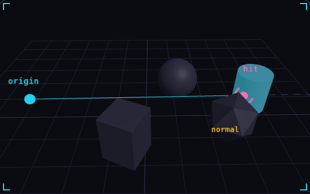</a> | [Raycasting](raycasting.md) | ask a line what it hits |
| 02 | <a href="normals.md">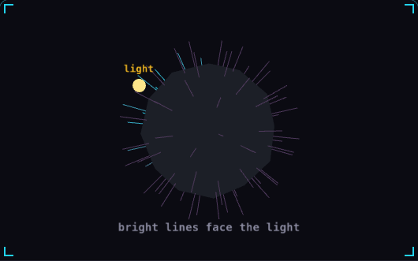</a> | [Normals](normals.md) | which way a surface faces |
| 03 | <a href="level-of-detail.md">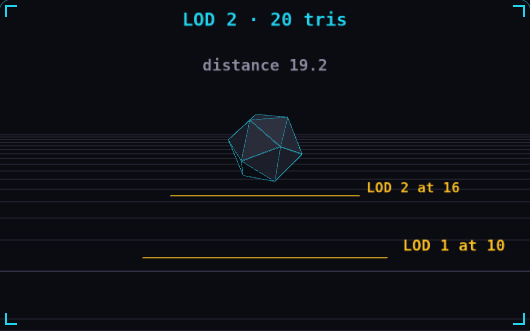</a> | [Level of detail](level-of-detail.md) | cheap mesh when it is far |
| 04 | <a href="frustum-culling.md">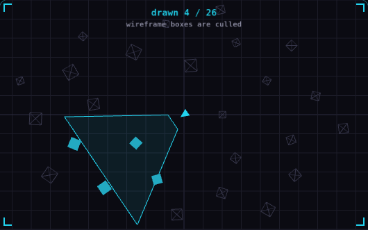</a> | [Frustum culling](frustum-culling.md) | skip what the camera cannot see |
| 05 | <a href="fragment-shader.md">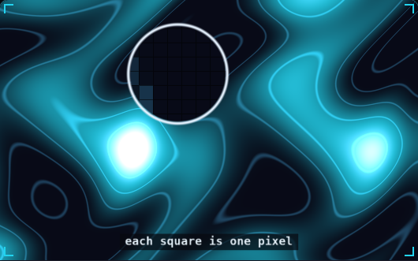</a> | [Fragment shader](fragment-shader.md) | a tiny program per pixel |
| 06 | <a href="billboarding.md">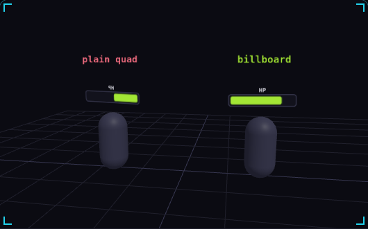</a> | [Billboarding](billboarding.md) | always turn to face the camera |
| 07 | <a href="quaternions.md">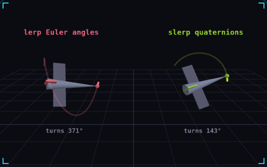</a> | [Quaternions](quaternions.md) | rotations that take the short way |
| 08 | <a href="z-fighting.md">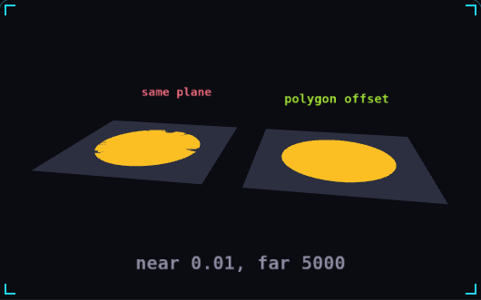</a> | [Z-fighting](z-fighting.md) | two surfaces fighting for pixels |

## Game feel

| # | Demo | Conceito | Resumo |
|---|---|---|---|
| 09 | <a href="delta-time.md">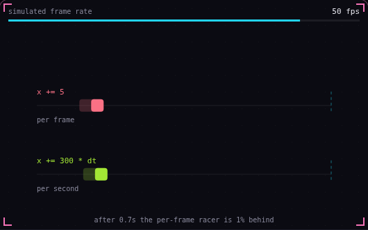</a> | [Delta time](delta-time.md) | move per second, not per frame |
| 10 | <a href="coyote-time.md">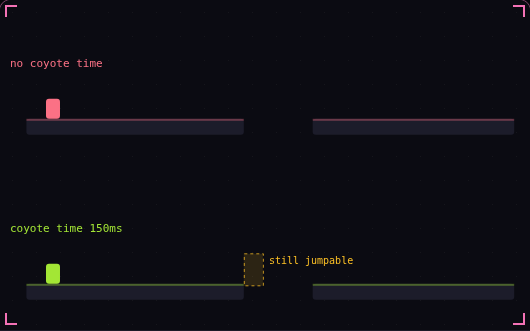</a> | [Coyote time](coyote-time.md) | a late jump that still counts |
| 11 | <a href="easing.md">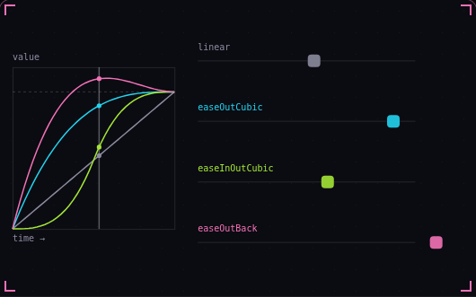</a> | [Easing](easing.md) | bend linear motion into curves |
| 12 | <a href="screen-shake.md">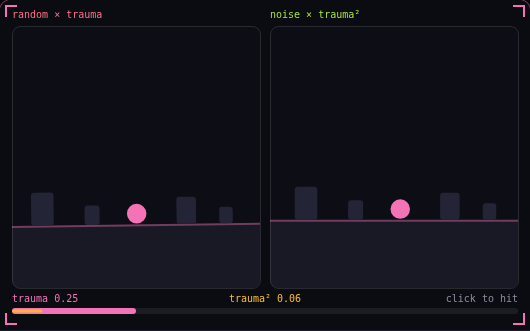</a> | [Screen shake](screen-shake.md) | one trauma value drives the shake |
| 13 | <a href="squash-and-stretch.md">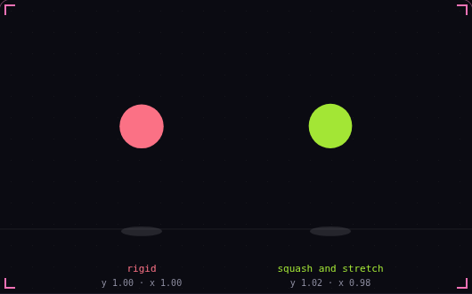</a> | [Squash and stretch](squash-and-stretch.md) | shape shows speed and impact |
| 14 | <a href="camera-deadzone.md">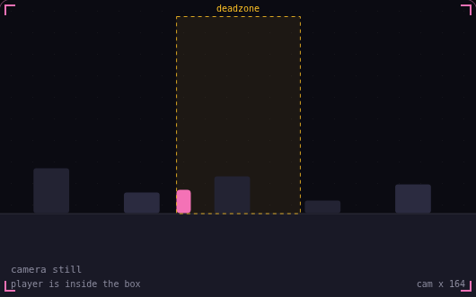</a> | [Camera deadzone](camera-deadzone.md) | let the player move first |
| 15 | <a href="input-buffering.md">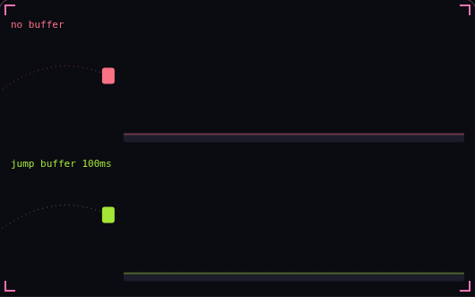</a> | [Input buffering](input-buffering.md) | an early press that still counts |
| 16 | <a href="acceleration-and-friction.md">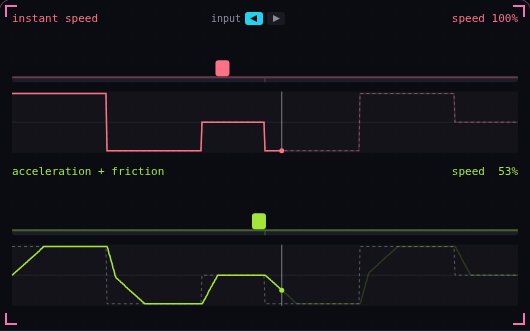</a> | [Acceleration and friction](acceleration-and-friction.md) | speed builds up and bleeds off |
| 17 | <a href="hit-stop.md">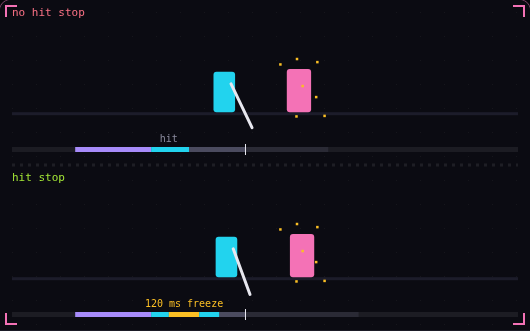</a> | [Hit stop](hit-stop.md) | freeze both fighters on impact |
| 18 | <a href="invincibility-frames.md">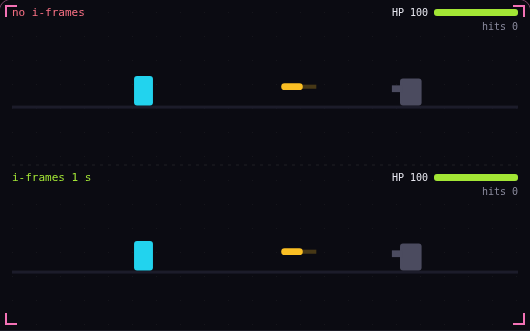</a> | [Invincibility frames](invincibility-frames.md) | brief safety after each hit |

## Systems

| # | Demo | Conceito | Resumo |
|---|---|---|---|
| 19 | <a href="object-pooling.md">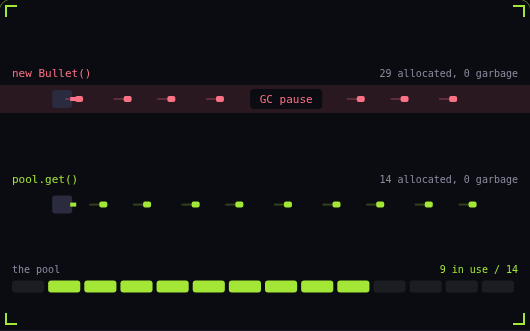</a> | [Object pooling](object-pooling.md) | allocate once, reuse forever |
| 20 | <a href="state-machine.md">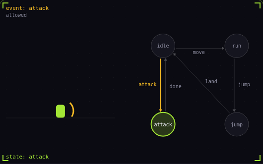</a> | [Finite state machine](state-machine.md) | one state at a time |
| 21 | <a href="hitbox-hurtbox.md">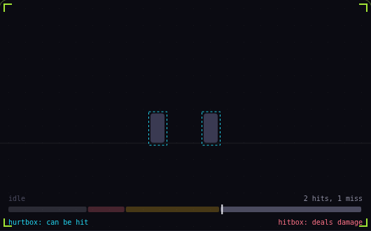</a> | [Hitbox and hurtbox](hitbox-hurtbox.md) | what hits, what gets hit |
| 22 | <a href="pathfinding.md">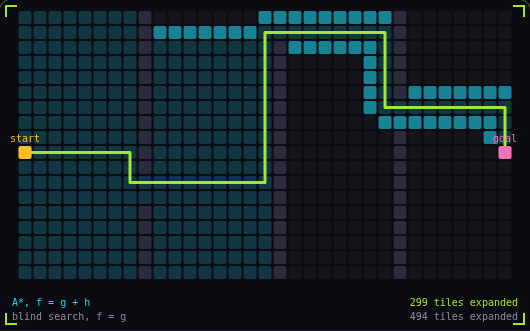</a> | [A* pathfinding](pathfinding.md) | search that aims at the goal |
| 23 | <a href="particle-system.md">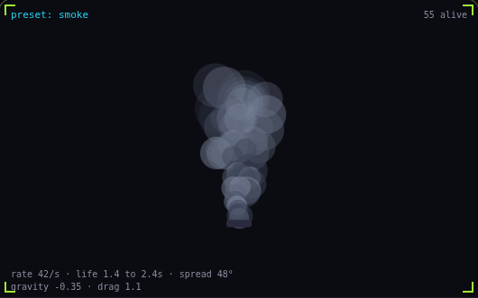</a> | [Particle system](particle-system.md) | one emitter, many short lives |
| 24 | <a href="fixed-timestep.md">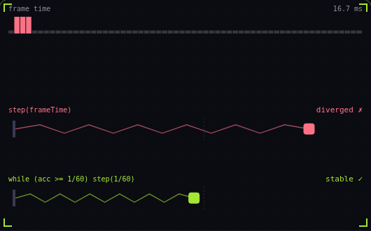</a> | [Fixed timestep](fixed-timestep.md) | physics on a steady clock |
| 25 | <a href="steering-behaviors.md">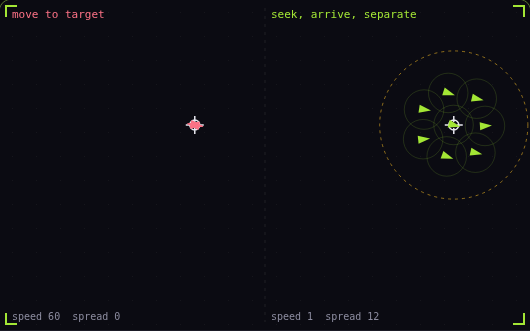</a> | [Steering behaviors](steering-behaviors.md) | nudge velocity toward a goal |
| 26 | <a href="tunneling.md">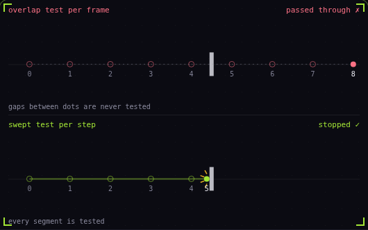</a> | [Tunneling](tunneling.md) | fast objects skip through walls |
| 27 | <a href="seeded-noise.md">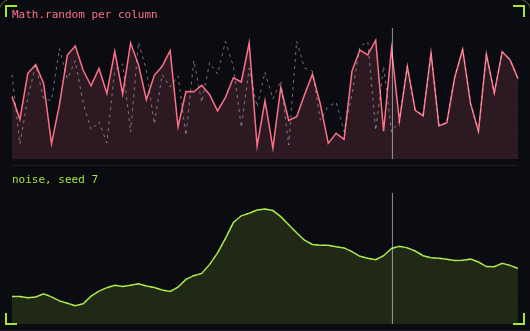</a> | [Seeded noise](seeded-noise.md) | same seed, same world |

## Performance

| # | Demo | Conceito | Resumo |
|---|---|---|---|
| 28 | <a href="frame-budget.md">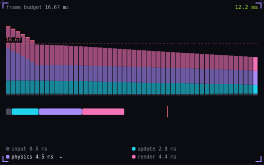</a> | [Frame budget](frame-budget.md) | 16.67 ms, and where it goes |
| 29 | <a href="draw-calls.md">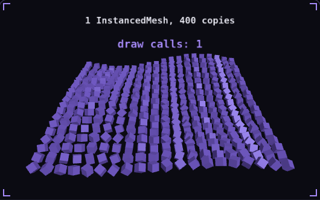</a> | [Draw calls](draw-calls.md) | one call, four hundred crates |
| 30 | <a href="spatial-partitioning.md">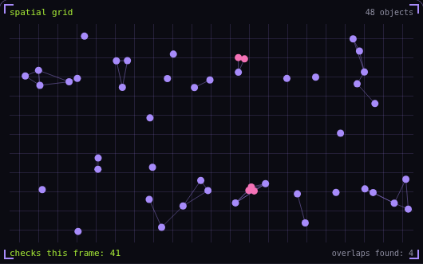</a> | [Spatial partitioning](spatial-partitioning.md) | only test what is nearby |
| 31 | <a href="overdraw.md">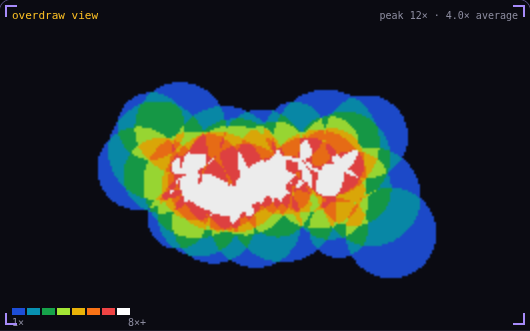</a> | [Overdraw](overdraw.md) | the same pixel, shaded again |
| 32 | <a href="time-slicing.md">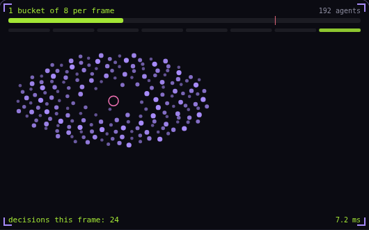</a> | [Time slicing](time-slicing.md) | spread the work across frames |
| 33 | <a href="texture-atlas.md">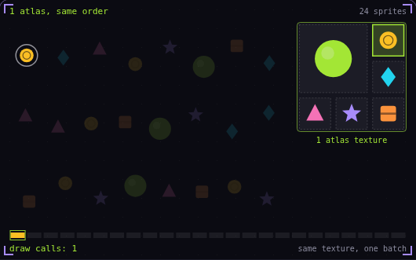</a> | [Texture atlas](texture-atlas.md) | one texture, one draw call |
| 34 | <a href="chunk-streaming.md">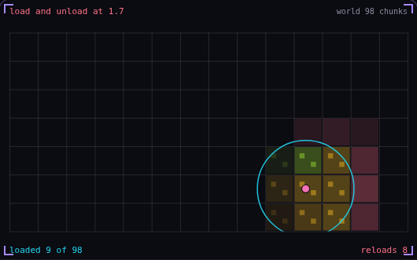</a> | [Chunk streaming](chunk-streaming.md) | load only what is near the player |
