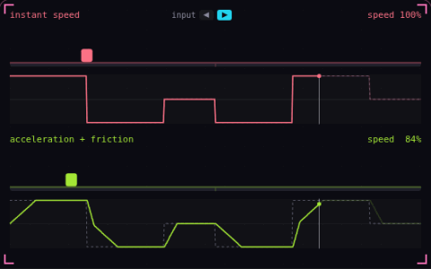

# 16. Acceleration and friction

**Game feel** · _speed builds up and bleeds off_



Acceleration and friction move the velocity toward the input speed by a set amount per second, instead of setting it in one frame. The bottom character reaches full speed in 0.2 s, stops 0.1 s after release, and brakes twice as hard when the input flips direction. The top character copies the input directly, so its speed trace is a square wave and it starts, stops and turns around in a single frame.

## Prompt bit

```text
Give horizontal movement acceleration and friction: each frame move the velocity toward input times max speed with an acceleration that reaches max speed in 0.1 to 0.2 s, decelerate to a stop in about 0.1 s when no direction is held, use twice that deceleration when the input points against the current velocity, and halve both rates while airborne.
```

## When to use it

Use acceleration to make movement build speed and deceleration to control how quickly the player stops. Different ground, air, and reversal rates can create distinct movement feel.

## Implementation example

Engine-neutral pseudocode. Adapt the functions and coordinate conventions to your engine.

```
target = inputAxis * maxSpeed
rate = acceleration if inputAxis != 0 else deceleration
if target * velocity.x < 0: rate = reversalRate
velocity.x = moveTowards(velocity.x, target, rate * dt)
```

## Common mistakes

A controller’s deceleration setting is not necessarily physical friction. Use consistent units and test reversals, airborne steering, and slopes at several frame rates.

## Related concepts

- [Delta time](delta-time.md) — move per second, not per frame
- [Coyote time](coyote-time.md) — a late jump that still counts
- [Steering behaviors](steering-behaviors.md) — nudge velocity toward a goal

---
Source: <https://gamedev-cheatsheet.com/concepts/acceleration-and-friction/> — by Nicolas Zullo
