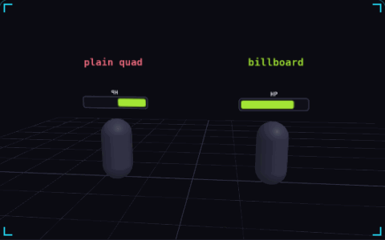

# 06. Billboarding

**3D & rendering** · _always turn to face the camera_



A billboard is a flat quad that is rotated every frame to face the camera. Health bars, damage numbers, name tags and distant trees are billboards, so they read the same from any angle. In the demo, the left health bar is fixed to its character and turns edge on or mirrored, while the right one stays readable.

## Prompt bit

```text
Make the health bars and name tags billboards: each frame, set each quad's world rotation to the camera's rotation so it faces the screen, and for trees and other upright sprites rotate only around the Y axis so they stay vertical.
```

## When to use it

Use billboards for floating labels, damage numbers, and sprites that should face the camera. Choose between full camera-facing rotation and a constrained upright billboard for trees or characters.

## Implementation example

Engine-neutral pseudocode. Adapt the functions and coordinate conventions to your engine.

```
label.worldRotation = camera.worldRotation
// Upright alternative:
direction = camera.position - tree.position
direction.y = 0
tree.lookAlong(normalize(direction))
```

## Common mistakes

Copying a world-space camera rotation into a local-space child transform can produce the wrong orientation. Account for the parent transform and your quad’s forward axis.

## Further reading

- [Three.js manual](https://threejs.org/manual/)

## Related concepts

- [Quaternions](quaternions.md) — rotations that take the short way
- [Particle system](particle-system.md) — one emitter, many short lives
- [Overdraw](overdraw.md) — the same pixel, shaded again

---
Source: <https://gamedev-cheatsheet.com/concepts/billboarding/> — by Nicolas Zullo
