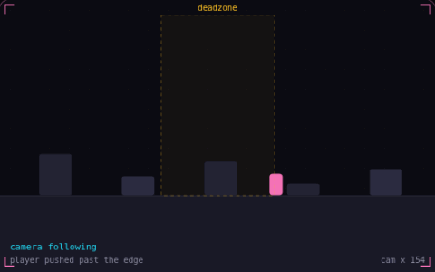

# 14. Camera deadzone

**Game feel** · _let the player move first_



A camera deadzone is a box in the middle of the screen where the player can move while the camera stays still. When the player pushes past an edge, the camera moves just enough to keep them on that edge, so small steps and turnarounds leave the view steady. Here the camera holds still each time the player turns back and crosses the box.

## Prompt bit

```text
Give the follow camera a deadzone: keep the camera still while the player is inside a centered box about a quarter of the screen wide, and when they cross an edge, move the camera by exactly how far they went past it.
```

## When to use it

Use a deadzone when small player movements should not constantly move the view. Combine it with world bounds, and optionally a small look-ahead offset in the movement direction.

## Implementation example

Engine-neutral pseudocode. Adapt the functions and coordinate conventions to your engine.

```
offset = player.position - camera.position
excess.x = offset.x - clamp(offset.x, -halfWidth, halfWidth)
excess.y = offset.y - clamp(offset.y, -halfHeight, halfHeight)
camera.position += excess
```

## Common mistakes

Clamp the final camera target to level bounds. If smoothing is added, distinguish the target deadzone from the lagging camera position to avoid oscillation near the edges.

## Related concepts

- [Screen shake](screen-shake.md) — one trauma value drives the shake
- [Easing](easing.md) — bend linear motion into curves
- [Delta time](delta-time.md) — move per second, not per frame

---
Source: <https://gamedev-cheatsheet.com/concepts/camera-deadzone/> — by Nicolas Zullo
