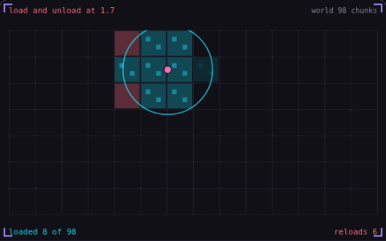

# 34. Chunk streaming

**Performance** · _load only what is near the player_



Chunk streaming splits a large world into fixed-size chunks and keeps only the chunks near the player in memory, here 8 to 14 of the 98, the same count a world of 10,000 chunks would need. Chunks load inside the solid circle and unload only outside the larger dashed one, so the player pacing on a chunk border causes no reloads. With a single radius, the same pacing drops and reloads chunks 8 times in 2 seconds.

## Prompt bit

```text
Stream the world in fixed-size chunks of 32 by 32 tiles, keep every chunk within 2 chunks of the player loaded, load new chunks asynchronously off the main thread, unload a chunk only once it is more than 3 chunks away so a player standing on a border does not cause reloads, and reuse chunk objects from a pool.
```

## When to use it

Use chunks to keep a large world’s active memory and simulation local to the player. Build chunk data asynchronously, then activate rendering and physics on the appropriate thread.

## Implementation example

Engine-neutral pseudocode. Adapt the functions and coordinate conventions to your engine.

```
for chunk in chunksWithin(player, loadRadius):
  requestLoad(chunk)
for chunk in loadedChunks:
  if distance(player, chunk) > unloadRadius:
    requestUnload(chunk)
// Keep unloadRadius greater than loadRadius.
```

## Common mistakes

Do not unload a chunk with pending saves or references from active neighbors. Budget activation work too: loading on a background thread can still cause a frame spike when many objects are created at once.

## Related concepts

- [Seeded noise](seeded-noise.md) — same seed, same world
- [Object pooling](object-pooling.md) — allocate once, reuse forever
- [Time slicing](time-slicing.md) — spread the work across frames

---
Source: <https://gamedev-cheatsheet.com/concepts/chunk-streaming/> — by Nicolas Zullo
