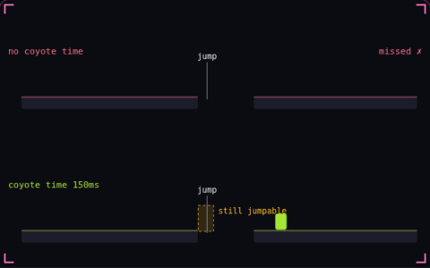

# 10. Coyote time

**Game feel** · _a late jump that still counts_



Coyote time lets the player still jump for a short window, usually 0.1 to 0.15 s, after running off a ledge. Players often press jump a few frames too late, and without the window the game ignores that press and they fall. Both runners here press jump at the same late moment, and only the one with coyote time clears the gap.

## Prompt bit

```text
Add coyote time to the jump: track the time since the player last stood on the ground, allow a jump while it is under 0.12 s, and use up that window when the jump fires so the window cannot give a second jump.
```

## When to use it

Use a short grace period when a platformer should accept a jump just after the player leaves a ledge. Keep it separate from jump buffering, which remembers an early button press.

## Implementation example

Engine-neutral pseudocode. Adapt the functions and coordinate conventions to your engine.

```
if grounded: grace = 0.12
else: grace = max(0, grace - dt)
if jumpPressed and grace > 0:
  velocity.y = jumpSpeed
  grace = 0
```

## Common mistakes

Consume the grace period when a jump fires. Also prevent the takeoff frame from immediately refilling it from stale grounded state, or one press sequence may allow an extra jump.

## Further reading

- [Godot: Character body movement and collision](https://docs.godotengine.org/en/stable/tutorials/physics/using_character_body_2d.html)

## Related concepts

- [Input buffering](input-buffering.md) — an early press that still counts
- [Acceleration and friction](acceleration-and-friction.md) — speed builds up and bleeds off
- [Fixed timestep](fixed-timestep.md) — physics on a steady clock

---
Source: <https://gamedev-cheatsheet.com/concepts/coyote-time/> — by Nicolas Zullo
