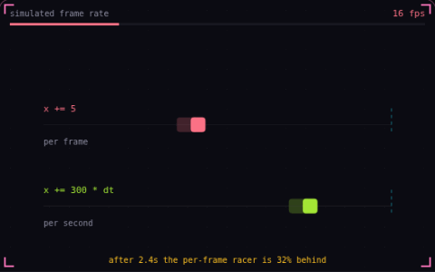

# 09. Delta time

**Game feel** · _move per second, not per frame_



Delta time is how long the previous frame took, in seconds. Multiply every speed by it and the game runs at the same pace at 30 fps and at 240 fps. Here the frame rate dips from 60 to 14 fps, and the racer that moves a fixed amount per frame falls behind.

## Prompt bit

```text
Make all movement frame-rate independent with delta time: multiply every speed by dt in seconds, add dt to every timer, smooth with 1 - exp(-k * dt) instead of a fixed lerp factor, and clamp dt to about 0.05 s so one long frame cannot teleport anything.
```

## When to use it

Use elapsed seconds for movement speeds, cooldowns, and UI animation. A value in units per second needs one multiplication by elapsed seconds to become a displacement.

## Implementation example

Engine-neutral pseudocode. Adapt the functions and coordinate conventions to your engine.

```
dt = min(frameSeconds, 0.05)
position += velocity * dt
cooldown = max(0, cooldown - dt)
blend = 1 - exp(-smoothing * dt)
```

## Common mistakes

Do not multiply by delta time twice. Clamping a long frame discards elapsed time, so fixed-step accumulation is a better fit for simulations that must account for that time.

## Further reading

- [Gaffer On Games: Fix Your Timestep](https://gafferongames.com/post/fix_your_timestep/)

## Related concepts

- [Fixed timestep](fixed-timestep.md) — physics on a steady clock
- [Acceleration and friction](acceleration-and-friction.md) — speed builds up and bleeds off
- [Easing](easing.md) — bend linear motion into curves

---
Source: <https://gamedev-cheatsheet.com/concepts/delta-time/> — by Nicolas Zullo
