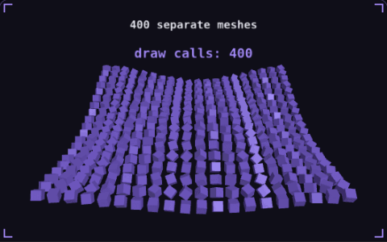

# 29. Draw calls

**Performance** · _one call, four hundred crates_



A draw call is the CPU telling the GPU to draw one mesh, and the CPU spends time preparing each one. Instancing draws many copies of the same mesh and material in a single call, with a list of positions and rotations for the copies. The animation draws the same 400 crates both ways, and the count drops from 400 calls to 1.

## Prompt bit

```text
Use GPU instancing for repeated objects that share one mesh and one material, so each group renders in a single draw call with a per-instance transform buffer, and merge static meshes that share a material into one mesh.
```

## When to use it

Use instancing for many objects that share geometry and material. Batch compatible objects while preserving the visibility granularity needed to avoid drawing huge offscreen groups.

## Implementation example

Engine-neutral pseudocode. Adapt the functions and coordinate conventions to your engine.

```
for instance in visibleInstances:
  transforms.append(instance.worldMatrix)
instanceBuffer.upload(transforms)
drawInstanced(mesh, material, transforms.length)
```

## Common mistakes

Reducing draw calls does not automatically reduce triangles, shader cost, or transparent overdraw. Measure the actual bottleneck and remember that material changes can split a batch.

## Related concepts

- [Texture atlas](texture-atlas.md) — one texture, one draw call
- [Frustum culling](frustum-culling.md) — skip what the camera cannot see
- [Frame budget](frame-budget.md) — 16.67 ms, and where it goes

---
Source: <https://gamedev-cheatsheet.com/concepts/draw-calls/> — by Nicolas Zullo
