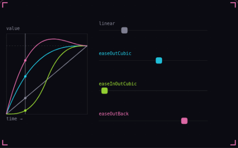

# 11. Easing

**Game feel** · _bend linear motion into curves_



An easing function maps linear progress from 0 to 1 onto a curve, so motion can slow down into its end point or overshoot and settle instead of moving at one constant speed. The plot on the left draws each curve, and each square on the right follows its curve over the same 1.5 seconds. Use it for any move with a known start, end and duration, such as a menu sliding in or a camera pan.

## Prompt bit

```text
Replace linear tweens with easing: compute t = elapsed / duration clamped between 0 and 1, set position = lerp(start, end, easeOutCubic(t)), use about 0.3 s for UI moves, and switch to easeOutBack when the motion should overshoot slightly before settling.
```

## When to use it

Use easing for a motion with a known start, target, and duration. Use a velocity-based controller instead when the target keeps moving or the object must react physically.

## Implementation example

Engine-neutral pseudocode. Adapt the functions and coordinate conventions to your engine.

```
t = clamp(elapsed / duration, 0, 1)
eased = 1 - pow(1 - t, 3)
position = start + (target - start) * eased
```

## Common mistakes

Do not repeatedly replace the start value with the current position while using elapsed progress. That changes the curve. Some easing functions intentionally overshoot, so avoid them for bounded values.

## Related concepts

- [Delta time](delta-time.md) — move per second, not per frame
- [Quaternions](quaternions.md) — rotations that take the short way
- [Squash and stretch](squash-and-stretch.md) — shape shows speed and impact

---
Source: <https://gamedev-cheatsheet.com/concepts/easing/> — by Nicolas Zullo
