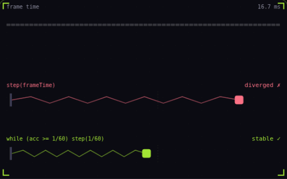

# 24. Fixed timestep

**Systems** · _physics on a steady clock_



A fixed timestep advances physics in constant slices, here 1/60 of a second, whatever the frame rate. Each frame adds its duration to an accumulator and runs as many slices as fit, carrying the rest to the next frame. The top spring steps by the raw frame time instead, so a short burst of 92 ms frames makes it gain energy and explode.

## Prompt bit

```text
Run physics on a fixed 60 Hz timestep: add each frame's delta time to an accumulator capped at 0.25 s, step the simulation by 1/60 s while the accumulator holds at least that much, and draw objects interpolated between the last two physics states using the leftover fraction.
```

## When to use it

Use a fixed timestep for repeatable physics updates and stable integration. Render interpolation smooths motion between ticks without changing the simulation’s tick rate.

## Implementation example

Engine-neutral pseudocode. Adapt the functions and coordinate conventions to your engine.

```
accumulator += min(frameSeconds, 0.25)
while accumulator >= step:
  previous = current
  current = simulate(current, step)
  accumulator -= step
render(lerp(previous, current, accumulator / step))
```

## Common mistakes

If simulation takes longer than the time it advances, the backlog can grow without bound. Set a catch-up budget and an explicit policy for overload. A fixed timestep alone does not guarantee cross-machine determinism.

## Further reading

- [Gaffer On Games: Fix Your Timestep](https://gafferongames.com/post/fix_your_timestep/)

## Related concepts

- [Delta time](delta-time.md) — move per second, not per frame
- [Tunneling](tunneling.md) — fast objects skip through walls
- [Frame budget](frame-budget.md) — 16.67 ms, and where it goes

---
Source: <https://gamedev-cheatsheet.com/concepts/fixed-timestep/> — by Nicolas Zullo
