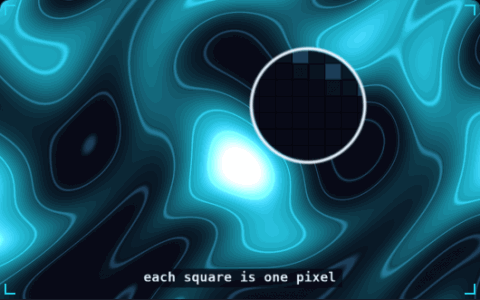

# 05. Fragment shader

**3D & rendering** · _a tiny program per pixel_



A fragment shader is a small program that the GPU runs once for every pixel a surface covers, to decide that pixel's colour. Each run gets its own inputs, such as the UV coordinate and the time, and thousands of runs happen in parallel. The magnifier in the demo shows the pixels as squares, each one the result of a separate run.

## Prompt bit

```text
Write this effect as a GLSL fragment shader: compute each pixel's colour from its UV and a uTime uniform, and expose speed, scale and colours as uniforms so they can be tuned without touching the shader code.
```

## When to use it

Use a fragment shader for surface patterns, dissolves, tinting, and effects that can be computed independently for each fragment. A fragment is a candidate pixel contribution; depth tests and blending determine the final image.

## Implementation example

Engine-neutral pseudocode. Adapt the functions and coordinate conventions to your engine.

```
vec2 uv = vUv;
float wave = 0.5 + 0.5 * sin(uv.x * uScale + uTime);
vec3 color = mix(uColorA, uColorB, wave);
fragColor = vec4(color, 1.0);
```

## Common mistakes

A cheap-looking shader can become expensive when it covers the whole screen or is drawn many times. Check texture samples, transparency, and overdraw before adding more math.

## Further reading

- [Three.js manual](https://threejs.org/manual/)

## Related concepts

- [Normals](normals.md) — which way a surface faces
- [Overdraw](overdraw.md) — the same pixel, shaded again
- [Texture atlas](texture-atlas.md) — one texture, one draw call

---
Source: <https://gamedev-cheatsheet.com/concepts/fragment-shader/> — by Nicolas Zullo
