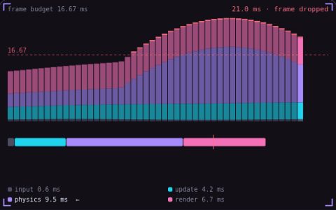

# 28. Frame budget

**Performance** · _16.67 ms, and where it goes_



At 60 fps the game has 16.67 milliseconds to finish each frame, and input, game logic, physics and rendering all share that time. A frame that takes longer misses the screen refresh, and the player sees a stutter. Measure how long each system takes and fix the largest one first, like the physics spikes that push frames over the red line here.

## Prompt bit

```text
Before optimising, time input, update, physics and render every frame with performance.now(), show each one in milliseconds against the 16.67 ms budget for 60 fps, and optimise the largest one first.
```

## When to use it

Use per-system timings to find which work exceeds the target frame duration. Measure representative heavy scenes and slow frames, not only the average FPS in an empty level.

## Implementation example

Engine-neutral pseudocode. Adapt the functions and coordinate conventions to your engine.

```
start = now()
updateSimulation()
simulationMs = now() - start
start = now()
submitRendering()
renderSubmissionMs = now() - start
```

## Common mistakes

CPU submission time is not GPU execution time. Use GPU timings when available, inspect high-percentile frame times, and compare the same scene before and after an optimization.

## Related concepts

- [Draw calls](draw-calls.md) — one call, four hundred crates
- [Overdraw](overdraw.md) — the same pixel, shaded again
- [Time slicing](time-slicing.md) — spread the work across frames

---
Source: <https://gamedev-cheatsheet.com/concepts/frame-budget/> — by Nicolas Zullo
