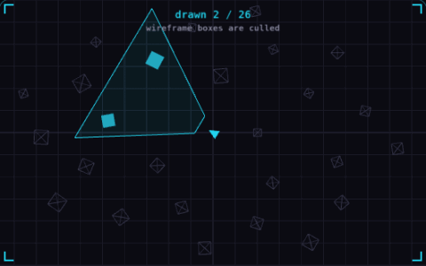

# 04. Frustum culling

**3D & rendering** · _skip what the camera cannot see_



The frustum is the part of the world a camera can see, shaped like a pyramid with its tip cut off. Frustum culling tests each object's bounding volume against it and skips the objects outside, so the GPU spends no time on them. In the demo the camera turns, and only the boxes inside the cyan wedge are drawn solid.

## Prompt bit

```text
Add frustum culling: each frame, build a frustum from the camera's projection and view matrices, test each object's bounding sphere against it, and skip both the draw and the animation update for objects fully outside.
```

## When to use it

Use frustum culling to skip render work outside the camera view. It is different from occlusion culling, which also tries to skip objects hidden behind other objects.

## Implementation example

Engine-neutral pseudocode. Adapt the functions and coordinate conventions to your engine.

```
frustum = extractPlanes(projection * view)
for object in scene:
  if frustum.intersects(object.worldBounds):
    draw(object)
```

## Common mistakes

An object origin can be outside the screen while part of its mesh is visible. Test conservative bounds, and update those bounds when animations or procedural geometry change.

## Further reading

- [Three.js manual](https://threejs.org/manual/)

## Related concepts

- [Level of detail](level-of-detail.md) — cheap mesh when it is far
- [Spatial partitioning](spatial-partitioning.md) — only test what is nearby
- [Draw calls](draw-calls.md) — one call, four hundred crates

---
Source: <https://gamedev-cheatsheet.com/concepts/frustum-culling/> — by Nicolas Zullo
