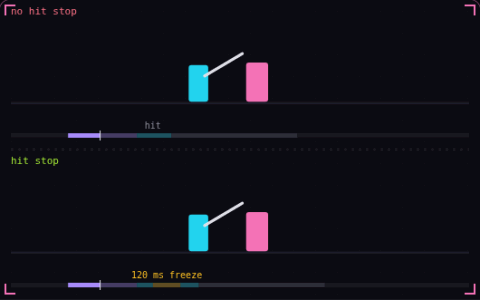

# 17. Hit stop

**Game feel** · _freeze both fighters on impact_



Hit stop pauses the attacker and the target for 50 to 100 ms when a hit lands. Without it, the blade crosses the target in 2 or 3 frames and the contact is hard to see. The bottom swing freezes for 120 ms, a bit longer than usual so you can see the gap in its timeline, while the sparks keep moving.

## Prompt bit

```text
Add hit stop: when a hit lands, pause the animation and movement of the attacker and the target for 50 to 100 ms scaled by the damage, keep reading and buffering input during the pause, and keep UI and particles running at normal speed.
```

## When to use it

Use a brief local freeze at the moment of contact to make an impact legible. Keep input collection active, and choose explicitly whether particles, camera motion, and UI continue during the freeze.

## Implementation example

Engine-neutral pseudocode. Adapt the functions and coordinate conventions to your engine.

```
onHit(damage):
  hitStopRemaining = durationFor(damage)
update(dt):
  readAndBufferInput()
  if hitStopRemaining > 0:
    hitStopRemaining -= dt
  else:
    updateFighters(dt)
```

## Common mistakes

A global time scale can freeze menus, networking, or the timer that should end hit stop. Advance the stop timer with an unscaled clock and avoid repeatedly extending it from one persistent overlap.

## Related concepts

- [Screen shake](screen-shake.md) — one trauma value drives the shake
- [Input buffering](input-buffering.md) — an early press that still counts
- [Hitbox and hurtbox](hitbox-hurtbox.md) — what hits, what gets hit

---
Source: <https://gamedev-cheatsheet.com/concepts/hit-stop/> — by Nicolas Zullo
