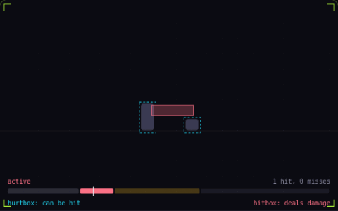

# 21. Hitbox and hurtbox

**Systems** · _what hits, what gets hit_



A hitbox is the area of an attack that deals damage, and it exists only during the attack's active frames. A hurtbox is the area of a character that can take damage. A hit lands only when the two overlap, so the defender's duck here makes every second swing miss.

## Prompt bit

```text
Separate hitboxes from hurtboxes: enable each hitbox only during the attack's active frames, test it against the target's hurtboxes instead of sprite bounds, and register at most one hit per target per swing.
```

## When to use it

Use separate attack and damage-receiving volumes when animation timing matters. A single attack instance should record which targets it already hit, independently from the defender’s invulnerability timer.

## Implementation example

Engine-neutral pseudocode. Adapt the functions and coordinate conventions to your engine.

```
if attack.isActive:
  for target in overlaps(attack.hitbox):
    if target not in attack.hitTargets:
      applyHit(target)
      attack.hitTargets.add(target)
```

## Common mistakes

Reset the hit-target set for a new swing, not every frame. Sprite bounds often include empty space and usually make poor combat collision shapes.

## Related concepts

- [Invincibility frames](invincibility-frames.md) — brief safety after each hit
- [Hit stop](hit-stop.md) — freeze both fighters on impact
- [Raycasting](raycasting.md) — ask a line what it hits

---
Source: <https://gamedev-cheatsheet.com/concepts/hitbox-hurtbox/> — by Nicolas Zullo
