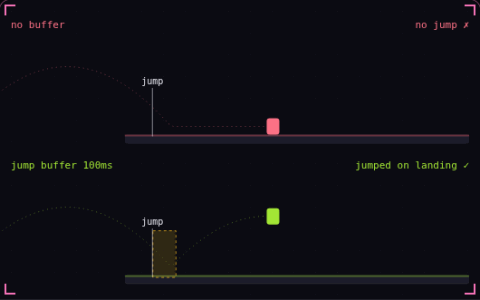

# 15. Input buffering

**Game feel** · _an early press that still counts_



Input buffering remembers a button press for a short window, usually about 0.1 s, and performs the action on the first frame it becomes possible. Players often press jump a few frames before they land, and without a buffer the game drops that press because the character is still in the air. Both characters here press jump 0.08 s before landing, and only the one with a 0.1 s buffer jumps on the frame it touches down.

## Prompt bit

```text
Add a jump input buffer: when the player presses jump, set a buffer timer to 0.1 s that counts down every frame, fire the jump on the first frame the player is grounded while that timer is above 0, and reset the timer to 0 when the jump fires so one press gives one jump.
```

## When to use it

Use a short input buffer when an action should happen on the first eligible frame after a press. Jumping just before landing and queuing an attack near recovery are common uses.

## Implementation example

Engine-neutral pseudocode. Adapt the functions and coordinate conventions to your engine.

```
if jumpPressed: buffer = 0.1
else: buffer = max(0, buffer - dt)
if canJump and buffer > 0:
  jump()
  buffer = 0
```

## Common mistakes

Consume the input once. A buffer is different from repeatedly reading a held button, and an excessively long window can trigger actions the player no longer expects.

## Related concepts

- [Coyote time](coyote-time.md) — a late jump that still counts
- [Finite state machine](state-machine.md) — one state at a time
- [Hit stop](hit-stop.md) — freeze both fighters on impact

---
Source: <https://gamedev-cheatsheet.com/concepts/input-buffering/> — by Nicolas Zullo
