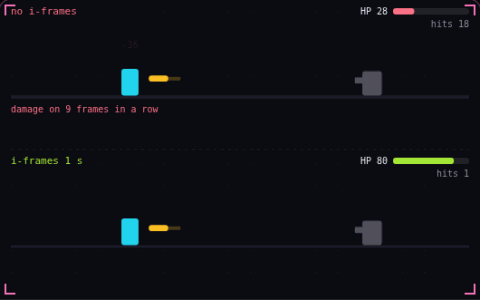

# 18. Invincibility frames

**Game feel** · _brief safety after each hit_



Invincibility frames, or i-frames, are a window of 0.5 to 1 s after a hit during which the character ignores further damage. Without them, a bolt that overlaps the character for 9 frames deals damage on all 9, and three bolts empty the top health bar. The bottom character takes one hit, gets knocked back, and blinks for 1 s while the next bolt passes through without dealing damage.

## Prompt bit

```text
Add invincibility frames: after the player takes damage, ignore all further damage for 0.5 to 1 s, blink the sprite on and off at about 10 Hz during that window, and apply a knockback impulse that pushes the player away from the damage source.
```

## When to use it

Use a damage cooldown after a hit or during selected dodge frames. The visual feedback should communicate protection, while the damage system enforces it independently of sprite visibility.

## Implementation example

Engine-neutral pseudocode. Adapt the functions and coordinate conventions to your engine.

```
if incomingHit and invulnerability <= 0:
  health -= damage
  invulnerability = 0.75
invulnerability = max(0, invulnerability - dt)
visual.visible = invulnerability <= 0 or blinkPhase(time)
```

## Common mistakes

Blinking alone does not prevent damage. Decide which damage types ignore invulnerability, and distinguish a per-target cooldown from preventing repeated hits by a single attack.

## Related concepts

- [Hitbox and hurtbox](hitbox-hurtbox.md) — what hits, what gets hit
- [Hit stop](hit-stop.md) — freeze both fighters on impact
- [Finite state machine](state-machine.md) — one state at a time

---
Source: <https://gamedev-cheatsheet.com/concepts/invincibility-frames/> — by Nicolas Zullo
