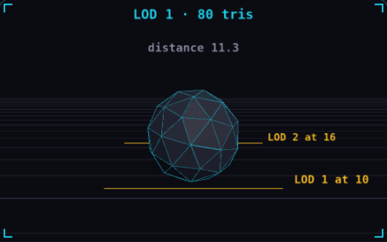

# 03. Level of detail

**3D & rendering** · _cheap mesh when it is far_



Level of detail, or LOD, swaps a model for a simpler version as it gets farther from the camera. A far object covers only a few pixels, so the extra triangles of the full mesh would not show and only cost GPU time. The rock in the demo drops from 1280 to 80 to 20 triangles as it crosses each distance line.

## Prompt bit

```text
Add LOD to the props: build three versions at about 100%, 30% and 10% of the triangles, switch between them at set camera distances, and add a 10% hysteresis band so a mesh standing near a threshold does not flicker between levels.
```

## When to use it

Use LOD when a detailed mesh becomes small on screen. The best thresholds depend on projected size, camera field of view, and the silhouettes you need to preserve.

## Implementation example

Engine-neutral pseudocode. Adapt the functions and coordinate conventions to your engine.

```
if distance > farThreshold + margin: level = LOW
else if distance < farThreshold - margin: level = MEDIUM
setVisibleMesh(level)
```

## Common mistakes

A hidden high-detail mesh should not keep running expensive animation or CPU updates. Check shadows and transitions too: a cheap mesh with a very different silhouette can pop visibly.

## Further reading

- [Three.js manual](https://threejs.org/manual/)

## Related concepts

- [Frustum culling](frustum-culling.md) — skip what the camera cannot see
- [Draw calls](draw-calls.md) — one call, four hundred crates
- [Frame budget](frame-budget.md) — 16.67 ms, and where it goes

---
Source: <https://gamedev-cheatsheet.com/concepts/level-of-detail/> — by Nicolas Zullo
