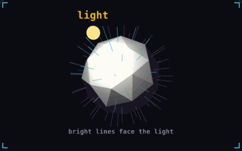

# 02. Normals

**3D & rendering** · _which way a surface faces_



A normal is a unit vector that points straight out of a surface. Lighting compares it with the direction to the light, so in the demo the faces whose normal lines point at the bulb are bright. Gameplay code uses the same vector to bounce objects off walls and to tell a floor from a steep slope.

## Prompt bit

```text
Use the surface normal from each collision or raycast hit: reflect the velocity around it for bounces, and count a surface as walkable floor only when the normal's up component is above 0.7, which is about 45 degrees.
```

## When to use it

Use a surface normal to calculate lighting, orient a decal, reflect a projectile, or decide whether a slope counts as ground. Keep the normal and the vectors you compare it with in the same coordinate space.

## Implementation example

Engine-neutral pseudocode. Adapt the functions and coordinate conventions to your engine.

```
normal = normalize(hit.worldNormal)
walkable = dot(normal, worldUp) >= cos(maxSlopeAngle)
bounce = velocity - 2 * dot(velocity, normal) * normal
```

## Common mistakes

A position vector is not a normal. Under non-uniform scale, transform normals with the inverse-transpose normal matrix, then normalize them again.

## Further reading

- [Three.js manual](https://threejs.org/manual/)

## Related concepts

- [Raycasting](raycasting.md) — ask a line what it hits
- [Fragment shader](fragment-shader.md) — a tiny program per pixel
- [Z-fighting](z-fighting.md) — two surfaces fighting for pixels

---
Source: <https://gamedev-cheatsheet.com/concepts/normals/> — by Nicolas Zullo
