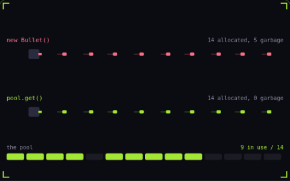

# 19. Object pooling

**Systems** · _allocate once, reuse forever_



A pool creates a fixed set of objects once and reuses them instead of creating a new one for every bullet. In C# or JavaScript each discarded object becomes garbage, and the garbage collector pauses the game to clean it up. The top lane stalls on those pauses while the pooled lane recycles the same 14 slots.

## Prompt bit

```text
Use an object pool for bullets and particles: preallocate the peak count up front, take an inactive instance and reset its fields on spawn, mark it inactive on death instead of destroying it, and log a warning if the pool ever runs out.
```

## When to use it

Use a pool for objects with frequent spawn and despawn cycles, such as bullets or effects. Set a capacity policy: reject a spawn, recycle an old effect, or grow outside the time-critical path.

## Implementation example

Engine-neutral pseudocode. Adapt the functions and coordinate conventions to your engine.

```
bullet = pool.acquire()
if bullet:
  bullet.reset(position, velocity, lifetime)
  bullet.active = true
// On expiry:
pool.release(bullet)
```

## Common mistakes

Reset every stateful field, including timers, targets, listeners, and visual flags. Pooling reduces allocation churn but does not make updating or drawing active objects free.

## Related concepts

- [Particle system](particle-system.md) — one emitter, many short lives
- [Frame budget](frame-budget.md) — 16.67 ms, and where it goes
- [Draw calls](draw-calls.md) — one call, four hundred crates

---
Source: <https://gamedev-cheatsheet.com/concepts/object-pooling/> — by Nicolas Zullo
