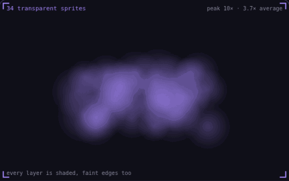

# 31. Overdraw

**Performance** · _the same pixel, shaded again_



Overdraw is the number of times the GPU shades the same pixel in one frame. Transparent sprites cannot hide what is behind them, so every layer of a smoke stack is shaded, and large sprites close to the camera cost the most. The overdraw view counts the layers on each pixel, from blue for one layer to white for eight or more.

## Prompt bit

```text
Reduce overdraw from transparent particles: cap how many can overlap, keep each sprite small on screen, trim sprite quads tightly around their visible pixels, and render heavy effects like smoke to a half-resolution buffer.
```

## When to use it

Use an overdraw view to diagnose scenes with many transparent sprites, smoke layers, or UI surfaces. Large overlapping quads can be costly even when their textures look mostly empty.

## Implementation example

Engine-neutral pseudocode. Adapt the functions and coordinate conventions to your engine.

```
for effect in visibleEffects:
  effect.maxParticles = qualityBudget
  effect.spriteBounds = tightBounds
renderHeavySmokeToHalfResolutionTarget()
compositeSmoke()
```

## Common mistakes

An alpha value of zero does not necessarily make fragment processing free. Tight geometry, fewer overlapping layers, and lower-resolution effects can matter more than reducing draw-call count.

## Related concepts

- [Particle system](particle-system.md) — one emitter, many short lives
- [Fragment shader](fragment-shader.md) — a tiny program per pixel
- [Draw calls](draw-calls.md) — one call, four hundred crates

---
Source: <https://gamedev-cheatsheet.com/concepts/overdraw/> — by Nicolas Zullo
