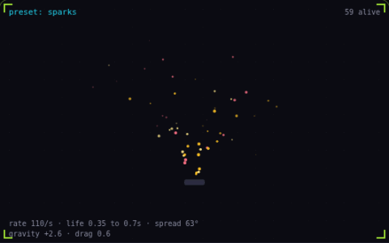

# 23. Particle system

**Systems** · _one emitter, many short lives_



A particle system spawns many short-lived sprites from one emitter and a handful of numbers: emission rate, lifetime, direction spread, speed, gravity and drag. Each particle also changes size and opacity over its own life. The sparks, smoke and confetti here are the same code with different numbers.

## Prompt bit

```text
Build this as a particle system: one emitter with tunable emission rate, lifetime range, direction spread, initial speed range, gravity and drag, size and opacity curves over each particle's life, and particles taken from a fixed preallocated pool.
```

## When to use it

Use one emitter configuration to produce many short-lived effects. Separate emission, simulation, and rendering so each can have its own budget and quality setting.

## Implementation example

Engine-neutral pseudocode. Adapt the functions and coordinate conventions to your engine.

```
spawnBudget += emissionRate * dt
while spawnBudget >= 1:
  spawnFromPool()
  spawnBudget -= 1
for particle in active:
  particle.velocity += gravity * dt
  particle.position += particle.velocity * dt
```

## Common mistakes

A fixed number of spawns per rendered frame changes density with frame rate. Also cap live particles and transparent overlap; pooling cannot solve an overdraw bottleneck.

## Related concepts

- [Object pooling](object-pooling.md) — allocate once, reuse forever
- [Overdraw](overdraw.md) — the same pixel, shaded again
- [Billboarding](billboarding.md) — always turn to face the camera

---
Source: <https://gamedev-cheatsheet.com/concepts/particle-system/> — by Nicolas Zullo
