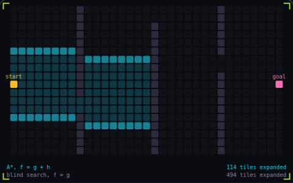

# 22. A* pathfinding

**Systems** · _search that aims at the goal_



A* searches a grid by always expanding the tile with the lowest cost so far plus an estimate of the distance left. The estimate steers the search towards the goal, so in this maze it expands about 40% fewer tiles than a blind search. As long as the estimate never overestimates, the path it returns is still the shortest.

## Prompt bit

```text
Use A* on the navigation grid with a binary heap for the open set, g as the cost so far, a Manhattan heuristic for 4-way movement or octile for 8-way, ties on f broken towards lower h, and the path rebuilt from parent links when the goal is popped.
```

## When to use it

Use A* when a unit needs a route through a graph of traversable positions. The graph handles where travel is possible; a separate movement controller follows the resulting route.

## Implementation example

Engine-neutral pseudocode. Adapt the functions and coordinate conventions to your engine.

```
open.push(start, priority = 0)
while open is not empty:
  current = open.popLowest()
  if current == goal: return reconstructPath(current)
  for next in neighbors(current):
    relaxEdge(current, next, cost + heuristic(next, goal))
```

## Common mistakes

The heuristic must not overestimate remaining cost for the usual shortest-path guarantee. Match it to allowed movement, and prevent diagonal corner cutting if a unit cannot fit through that gap.

## Further reading

- [Red Blob Games: Introduction to A*](https://www.redblobgames.com/pathfinding/a-star/introduction.html)

## Related concepts

- [Steering behaviors](steering-behaviors.md) — nudge velocity toward a goal
- [Spatial partitioning](spatial-partitioning.md) — only test what is nearby
- [Time slicing](time-slicing.md) — spread the work across frames

---
Source: <https://gamedev-cheatsheet.com/concepts/pathfinding/> — by Nicolas Zullo
