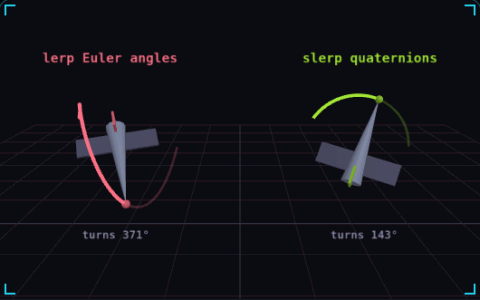

# 07. Quaternions

**3D & rendering** · _rotations that take the short way_



Euler angles store a rotation as three turns around the X, Y and Z axes, and blending those three numbers one by one sends the object on a detour. A quaternion stores the same rotation as four numbers, and slerp blends two of them along the shortest arc at a steady speed. Both ships turn between the same two orientations, and the nose trails show a 371° tumble on the left against a clean 143° arc on the right.

## Prompt bit

```text
Store rotations as quaternions, combine them by multiplication, interpolate with slerp and negate one of the two when their dot product is below 0 so it takes the short way, and convert to Euler angles only for display or editor input.
```

## When to use it

Use quaternions for camera turns, skeletal animation, and blending 3D orientations. They represent orientation, while angular velocity describes how quickly that orientation changes.

## Implementation example

Engine-neutral pseudocode. Adapt the functions and coordinate conventions to your engine.

```
a = normalize(startRotation)
b = normalize(targetRotation)
if dot(a, b) < 0: b = -b
rotation = slerp(a, b, clamp(elapsed / duration, 0, 1))
```

## Common mistakes

Quaternion multiplication is order-dependent. Normalize after accumulated numerical drift, and do not interpret the four components as four independent angles.

## Further reading

- [Three.js manual](https://threejs.org/manual/)

## Related concepts

- [Billboarding](billboarding.md) — always turn to face the camera
- [Easing](easing.md) — bend linear motion into curves
- [Normals](normals.md) — which way a surface faces

---
Source: <https://gamedev-cheatsheet.com/concepts/quaternions/> — by Nicolas Zullo
