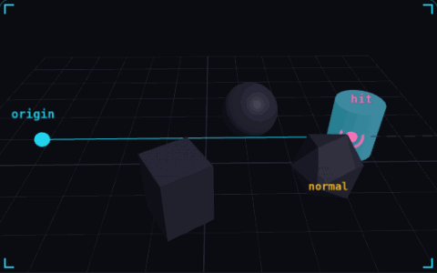

# 01. Raycasting

**3D & rendering** · _ask a line what it hits_



A raycast sends an invisible line from a point in a direction and returns the first object it touches. The result holds the hit point, the distance and the surface normal, shown here as the pink dot and the yellow arrow. Games use it for hitscan guns, line of sight, mouse picking and ground checks.

## Prompt bit

```text
Use a raycast for hit detection: cast from the muzzle along the aim direction with a max distance of 100 units and a layer mask that skips the shooter, take the closest hit, and use its point and surface normal to place the impact effect.
```

## When to use it

Use a raycast for a hitscan weapon, a ground probe, or selecting a unit under the cursor. A ray has no thickness: use a shape cast when the projectile or character needs clearance.

## Implementation example

Engine-neutral pseudocode. Adapt the functions and coordinate conventions to your engine.

```
direction = normalize(target - origin)
hit = world.raycast(origin, direction, maxDistance, collisionMask)
if hit:
  placeImpact(hit.point, hit.normal)
```

## Common mistakes

Keep the direction normalized, set a finite distance, and exclude the shooter. A raycast is a query; it does not move a rigid body or automatically apply damage.

## Further reading

- [Three.js manual](https://threejs.org/manual/)

## Related concepts

- [Normals](normals.md) — which way a surface faces
- [Tunneling](tunneling.md) — fast objects skip through walls
- [Hitbox and hurtbox](hitbox-hurtbox.md) — what hits, what gets hit

---
Source: <https://gamedev-cheatsheet.com/concepts/raycasting/> — by Nicolas Zullo
