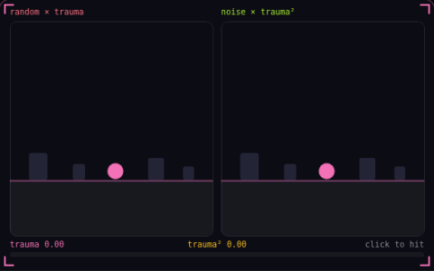

# 12. Screen shake

**Game feel** · _one trauma value drives the shake_



Screen shake moves the camera after a hit, driven by a trauma value from 0 to 1 that each hit raises and that falls back to 0 over about a second. The right view shakes by trauma squared times smooth noise, so the two light hits move a few pixels and the heavy hit moves far. The left view uses raw trauma and a new random offset every frame, so every hit jitters.

## Prompt bit

```text
Drive screen shake from a trauma value between 0 and 1: each hit adds 0.3 to 0.6, trauma decays by about 1 per second, and each frame the camera x, y and roll offsets equal a max offset times trauma squared times smooth Perlin noise, not fresh random numbers.
```

## When to use it

Use short, decaying shake to communicate impact. Keep it on a visual camera offset so shake does not change gameplay aiming, collision tests, or the camera’s persistent follow position.

## Implementation example

Engine-neutral pseudocode. Adapt the functions and coordinate conventions to your engine.

```
trauma = clamp(trauma + impact, 0, 1)
trauma = max(0, trauma - decay * dt)
amplitude = trauma * trauma
cameraOffset.x = noise(time * frequency) * maxOffset * amplitude
```

## Common mistakes

Do not accumulate random offsets into the base camera position. Apply shake relative to a stable pose, and provide a reduced-motion or shake-strength setting.

## Related concepts

- [Hit stop](hit-stop.md) — freeze both fighters on impact
- [Camera deadzone](camera-deadzone.md) — let the player move first
- [Seeded noise](seeded-noise.md) — same seed, same world

---
Source: <https://gamedev-cheatsheet.com/concepts/screen-shake/> — by Nicolas Zullo
