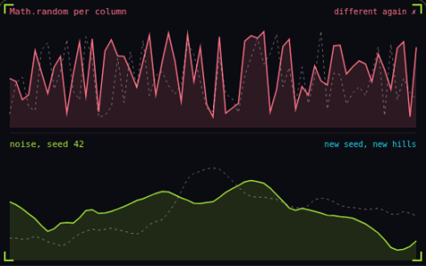

# 27. Seeded noise

**Systems** · _same seed, same world_



Seeded noise builds a world from a seeded random number generator, so the same seed always rebuilds the same world and a save only needs to store that one number. The top strip picks each of its 64 column heights with Math.random, so it is jagged and different on every regenerate. The bottom strip sums 4 octaves of value noise from a seeded generator, so its hills are smooth, the same seed redraws them exactly over the dashed outline, and a new seed gives new hills.

## Prompt bit

```text
Generate the world from a seeded PRNG such as mulberry32 feeding 2D Perlin or simplex noise with 3 to 5 octaves, each at double the frequency and half the amplitude of the one before, store the seed in the save file, and never call Math.random in world generation.
```

## When to use it

Use a seeded generator for worlds that should rebuild from a small seed. Smooth noise gives nearby coordinates related values, while independent random samples create abrupt changes.

## Implementation example

Engine-neutral pseudocode. Adapt the functions and coordinate conventions to your engine.

```
height = 0
frequency = baseFrequency
amplitude = 1
for octave in range(4):
  height += noise(seed, x * frequency) * amplitude
  frequency *= 2
  amplitude *= 0.5
```

## Common mistakes

Keep the algorithm and sampling order stable across saves. A shared sequential random stream can shift the whole world when one extra random call is inserted; coordinate-based sampling avoids that dependency.

## Related concepts

- [Chunk streaming](chunk-streaming.md) — load only what is near the player
- [Screen shake](screen-shake.md) — one trauma value drives the shake
- [Particle system](particle-system.md) — one emitter, many short lives

---
Source: <https://gamedev-cheatsheet.com/concepts/seeded-noise/> — by Nicolas Zullo
