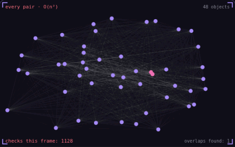

# 30. Spatial partitioning

**Performance** · _only test what is nearby_



Checking every pair of objects for collisions costs the square of the object count. The 48 objects here need 1,128 checks a frame, and 1,000 objects would need about 500,000. A spatial grid sorts objects into cells by position and tests each object only against objects in its own and neighbouring cells, which finds the same overlaps here with about 100 checks.

## Prompt bit

```text
Use a uniform spatial grid for broad-phase collision with cells about twice the size of the largest object, rebuild it every frame, and test each object only against objects in its own cell and the 8 neighbouring cells.
```

## When to use it

Use a grid or tree to narrow neighborhood and collision queries. Cell size should reflect object sizes and the query radius; there is no single best size for every game.

## Implementation example

Engine-neutral pseudocode. Adapt the functions and coordinate conventions to your engine.

```
cell = floor(position / cellSize)
grid[cell].add(object)
for neighborCell in cellsOverlapping(queryBounds):
  for candidate in grid[neighborCell]:
    runExactTest(candidate)
```

## Common mistakes

The grid is a broad phase, not the collision test itself. Account for objects spanning multiple cells and deduplicate candidate pairs before the narrow phase.

## Related concepts

- [Hitbox and hurtbox](hitbox-hurtbox.md) — what hits, what gets hit
- [Steering behaviors](steering-behaviors.md) — nudge velocity toward a goal
- [Frustum culling](frustum-culling.md) — skip what the camera cannot see

---
Source: <https://gamedev-cheatsheet.com/concepts/spatial-partitioning/> — by Nicolas Zullo
