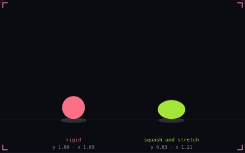

# 13. Squash and stretch

**Game feel** · _shape shows speed and impact_



Squash and stretch scales an object along its direction of motion. It stretches while it moves fast and flattens for a moment when it lands, and the other axis gets the inverse scale so its size looks constant. Both balls here follow the same bounce, and only the right one shows the speed and the impact in its shape.

## Prompt bit

```text
Add squash and stretch to the sprite: scale it up to about 1.3 along its velocity when it moves fast, squash it to about 0.7 on landing and ease back to 1 within 0.15 s, give the other axis the inverse scale so its area stays constant, and pivot at the feet so it stays on the ground.
```

## When to use it

Use a visual transform to emphasize velocity or landing impact. In 2D, applying an inverse scale to the other axis preserves area; in 3D, volume preservation needs compensation on two axes.

## Implementation example

Engine-neutral pseudocode. Adapt the functions and coordinate conventions to your engine.

```
stretch = 1.3
visual.scaleY = stretch
visual.scaleX = 1 / stretch
// Ease both values back to 1 after the impact.
```

## Common mistakes

Keep collision shapes independent unless changing collision is intentional. Place the visual pivot at the contact point so a squash does not appear to slide the character through the floor.

## Related concepts

- [Easing](easing.md) — bend linear motion into curves
- [Hit stop](hit-stop.md) — freeze both fighters on impact
- [Acceleration and friction](acceleration-and-friction.md) — speed builds up and bleeds off

---
Source: <https://gamedev-cheatsheet.com/concepts/squash-and-stretch/> — by Nicolas Zullo
