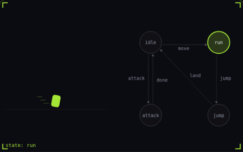

# 20. Finite state machine

**Systems** · _one state at a time_



A finite state machine keeps a character in exactly one state and lists which events move it to which state. An event with no matching transition is ignored, like the attack pressed in mid air here. This replaces a pile of booleans like isJumping and isAttacking that can end up true at the same time.

## Prompt bit

```text
Model the character with a finite state machine: one active state at a time, an explicit transition table keyed by state and event, events with no entry ignored, and enter, update and exit hooks on each state.
```

## When to use it

Use a state machine when behavior has distinct modes and clear transitions. An explicit transition table makes it easier to see whether jumping, attacking, or taking damage is permitted.

## Implementation example

Engine-neutral pseudocode. Adapt the functions and coordinate conventions to your engine.

```
next = transitions[currentState].get(event)
if next exists:
  states[currentState].exit()
  currentState = next
  states[currentState].enter()
```

## Common mistakes

Do not hide important transitions in unrelated flags. When movement and weapon states are independent, use separate state machines or a hierarchy instead of enumerating every possible combination.

## Related concepts

- [Input buffering](input-buffering.md) — an early press that still counts
- [Invincibility frames](invincibility-frames.md) — brief safety after each hit
- [Steering behaviors](steering-behaviors.md) — nudge velocity toward a goal

---
Source: <https://gamedev-cheatsheet.com/concepts/state-machine/> — by Nicolas Zullo
