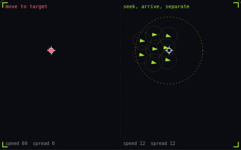

# 25. Steering behaviors

**Systems** · _nudge velocity toward a goal_



Steering behaviors move a unit by adding a force each frame that turns its current velocity toward a desired velocity, capped at a max force. Arrive lowers the desired speed inside a slowing radius, here the dashed circle, and separation pushes units apart when they get too close. On the left, eight units run at the target at full speed, overshoot it, flip back every frame and pile onto one point, while the eight on the right slow down and settle around it.

## Prompt bit

```text
Move units with steering behaviors: each frame compute steering as desired velocity minus current velocity, clamp it to a max force of about 4 times the max speed per second, and add it to the velocity; for arrive, scale the desired speed by distance divided by a slowing radius of about 4 unit widths, and add separation that pushes away from each neighbour closer than about 2 unit widths, harder the closer it is.
```

## When to use it

Use steering for smooth local movement toward a target or away from neighbors. Combine it with pathfinding when obstacles require route planning; steering alone can get trapped.

## Implementation example

Engine-neutral pseudocode. Adapt the functions and coordinate conventions to your engine.

```
desired = normalize(target - position) * desiredSpeed
steering = clampLength(desired - velocity, maxAcceleration)
velocity = clampLength(velocity + steering * dt, maxSpeed)
position += velocity * dt
```

## Common mistakes

Limit both acceleration and speed. For arrival, reduce desired speed near the destination rather than repeatedly overshooting it at full speed.

## Related concepts

- [A* pathfinding](pathfinding.md) — search that aims at the goal
- [Acceleration and friction](acceleration-and-friction.md) — speed builds up and bleeds off
- [Spatial partitioning](spatial-partitioning.md) — only test what is nearby

---
Source: <https://gamedev-cheatsheet.com/concepts/steering-behaviors/> — by Nicolas Zullo
