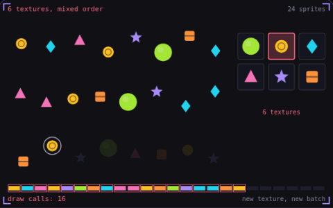

# 33. Texture atlas

**Performance** · _one texture, one draw call_



A texture atlas packs many small images into one large texture, and each sprite keeps the UV rectangle of its own region. The GPU has to start a new batch every time the bound texture changes, so these 24 sprites cost 22 draw calls when each of the 6 sprite types has its own texture. Packed into one atlas, the same 24 sprites in the same order draw in 1 call.

## Prompt bit

```text
Pack the sprites into one texture atlas, for example 2048 by 2048 with 2 px of padding around each sprite, store each sprite's UV rectangle in a JSON file, and draw every sprite that shares the atlas and shader in a single batch.
```

## When to use it

Use an atlas to let sprites share one texture binding. Each sprite stores a rectangle in UV space, while the material and draw order still determine whether sprites can share a batch.

## Implementation example

Engine-neutral pseudocode. Adapt the functions and coordinate conventions to your engine.

```
uvMin = sprite.pixelMin / atlasSize
uvMax = sprite.pixelMax / atlasSize
uv = mix(uvMin, uvMax, quadUV)
color = sample(atlas, uv)
```

## Common mistakes

Texture filtering and mipmaps can sample neighboring sprites. Extrude border pixels and leave enough padding for the mip levels you use; two pixels is not a universal guarantee.

## Related concepts

- [Draw calls](draw-calls.md) — one call, four hundred crates
- [Fragment shader](fragment-shader.md) — a tiny program per pixel
- [Particle system](particle-system.md) — one emitter, many short lives

---
Source: <https://gamedev-cheatsheet.com/concepts/texture-atlas/> — by Nicolas Zullo
