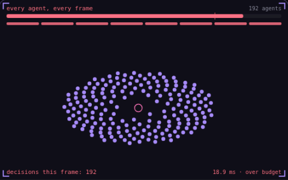

# 32. Time slicing

**Performance** · _spread the work across frames_



Time slicing spreads expensive work over several frames instead of running all of it every frame. Here 192 agents are split into 8 buckets, and each frame only one bucket, the lit cell under the cost bar, picks a new target, while all of them keep moving every frame. At 60 fps each agent now re-decides 7.5 times a second instead of 60, and the frame drops back under the 16.67 ms budget.

## Prompt bit

```text
Time-slice expensive AI updates by splitting agents into 4 to 8 buckets by index and running decisions like pathfinding or target selection for one bucket per frame, while movement and animation still update every frame.
```

## When to use it

Use time slicing for decisions that do not need to run every frame, such as distant AI planning. Keep immediate reactions and movement on the cadence their gameplay requires.

## Implementation example

Engine-neutral pseudocode. Adapt the functions and coordinate conventions to your engine.

```
bucket = frameIndex % bucketCount
for agent in agents:
  if agent.id % bucketCount == bucket:
    agent.chooseTarget()
  agent.move(dt)
```

## Common mistakes

Measure how much response delay the schedule adds. Give urgent tasks a separate budget, and avoid concentrating all expensive agents in the same bucket.

## Related concepts

- [Frame budget](frame-budget.md) — 16.67 ms, and where it goes
- [A* pathfinding](pathfinding.md) — search that aims at the goal
- [Steering behaviors](steering-behaviors.md) — nudge velocity toward a goal

---
Source: <https://gamedev-cheatsheet.com/concepts/time-slicing/> — by Nicolas Zullo
