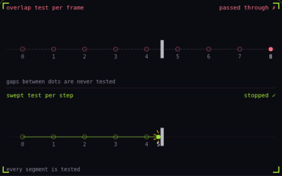

# 26. Tunneling

**Systems** · _fast objects skip through walls_



Tunneling happens when an object moves so far in one frame that it is in front of a wall before the step and behind it after, so a per frame overlap test never sees them touch. Here the bullet moves about 40 px per frame against a 6 px wall, and each dot marks one frame, slowed down. The top lane tests overlap only at the dots and lets the bullet through, while the bottom lane tests the whole segment between two dots and stops it at the wall.

## Prompt bit

```text
For fast objects like bullets, test the swept path from last frame's position to the new one with a raycast or shape cast, or sub-step the physics so each step moves less than half the object's size, and turn on continuous collision detection for fast rigidbodies.
```

## When to use it

Use swept collision detection for objects that can travel farther than a thin obstacle in one tick. A ray represents a point projectile; a sphere or capsule sweep represents an object with volume.

## Implementation example

Engine-neutral pseudocode. Adapt the functions and coordinate conventions to your engine.

```
next = position + velocity * dt
hit = sweepShape(shape, position, next)
if hit:
  position = hit.safePosition
  resolveImpact(hit)
else: position = next
```

## Common mistakes

Increasing render FPS does not fix a physics system that still samples at a low rate. Choose continuous collision detection or substeps according to the object’s speed, size, and collision needs.

## Related concepts

- [Raycasting](raycasting.md) — ask a line what it hits
- [Fixed timestep](fixed-timestep.md) — physics on a steady clock
- [Hitbox and hurtbox](hitbox-hurtbox.md) — what hits, what gets hit

---
Source: <https://gamedev-cheatsheet.com/concepts/tunneling/> — by Nicolas Zullo
