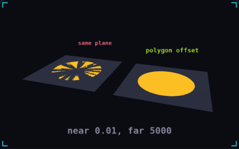

# 08. Z-fighting

**3D & rendering** · _two surfaces fighting for pixels_



Z-fighting is the flicker you get when two surfaces sit at the same depth, so rounding in the depth buffer picks the visible one pixel by pixel. The depth buffer spends most of its precision close to the near plane, so a near plane at 0.01 instead of 0.1 leaves distant surfaces with ten times less room. On the left the yellow decal lies exactly on the ground and breaks into flickering stripes, while on the right polygon offset pulls it toward the camera and it stays solid.

## Prompt bit

```text
Set the camera near plane as far out as the game allows, about 0.1, and the far plane as close as the view distance allows, never put two visible surfaces in the same plane, and lift decals about 1 cm along the surface normal or draw them with polygon offset, factor -1 and units -4.
```

## When to use it

Use polygon offset or a small geometric separation for decals drawn on an existing surface. Tighten the camera’s near and far planes to improve depth precision where possible.

## Implementation example

Engine-neutral pseudocode. Adapt the functions and coordinate conventions to your engine.

```
camera.near = 0.1
camera.far = requiredViewDistance
decal.position = hit.point + hit.normal * smallOffset
// Alternatively configure the material’s depth/polygon offset.
```

## Common mistakes

Pushing the near plane extremely close to zero can waste depth precision. Large offsets make decals float; tune offsets for the renderer and check from grazing angles.

## Further reading

- [Three.js manual](https://threejs.org/manual/)

## Related concepts

- [Normals](normals.md) — which way a surface faces
- [Fragment shader](fragment-shader.md) — a tiny program per pixel
- [Frame budget](frame-budget.md) — 16.67 ms, and where it goes

---
Source: <https://gamedev-cheatsheet.com/concepts/z-fighting/> — by Nicolas Zullo
