# Pixel Composer: 134 projetos de exemplo

Projetos oficiais de [Pixel Composer](https://pixel-composer.com/), editor de VFX e pixel art baseado em nós, feitos por **MakhamDev**. Fonte: [pixel-composer.com/showcases](https://pixel-composer.com/showcases.html).

Cada pasta em [`projects/`](projects/) traz o arquivo **`.pxc`** (o grafo de nós, abre direto no Pixel Composer) e as miniaturas originais. Em [`media/`](media/) estão as miniaturas ampliadas 4× (nearest-neighbor) para visualização.

## Como abrir

1. Instale o Pixel Composer: [Steam](https://store.steampowered.com/app/2299510/Pixel_Composer/), [itch.io](https://makham.itch.io/pixel-composer) ou compile o código [Ttanasart-pt/Pixel-Composer](https://github.com/Ttanasart-pt/Pixel-Composer) (MIT).
2. No Pixel Composer, abra `projects/<Projeto>/<arquivo>.pxc` com **File > Open**.
3. Estude o grafo, troque parâmetros e exporte como sprite sheet, GIF ou PNG para o seu jogo.

Mais projetos da comunidade: [Steam Workshop](https://steamcommunity.com/app/2299510/workshop/).

## Visão geral

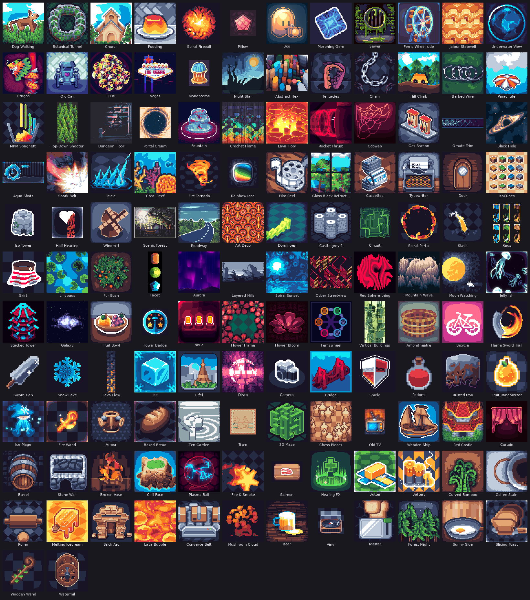

## Animados (40)

<table>
<tr>
<td align="center" width="16%"><a href="projects/Dog%20Walking">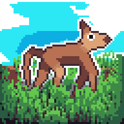</a> <b>Dog Walking</b> <a href="projects/Dog%20Walking/Dog-Walking_122003.pxc">.pxc</a></td>
<td align="center" width="16%"><a href="projects/Botanical%20Tunnel">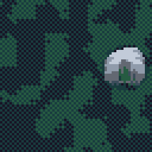</a> <b>Botanical Tunnel</b> <a href="projects/Botanical%20Tunnel/Botanical-Tunnel_122003.pxc">.pxc</a></td>
<td align="center" width="16%"> <b>Church</b> <a href="projects/Church/Church_122003.pxc">.pxc</a></td>
<td align="center" width="16%"><a href="projects/Pudding">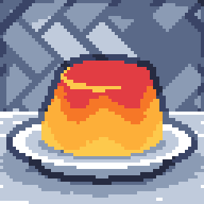</a> <b>Pudding</b> <a href="projects/Pudding/Pudding_122003.pxc">.pxc</a></td>
<td align="center" width="16%"><a href="projects/Spiral%20Fireball">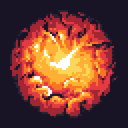</a> <b>Spiral Fireball</b> <a href="projects/Spiral%20Fireball/Spiral-Fireball_122003.pxc">.pxc</a></td>
<td align="center" width="16%"><a href="projects/Pillow">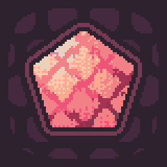</a> <b>Pillow</b> <a href="projects/Pillow/Pillow_122003.pxc">.pxc</a></td>
</tr>
<tr>
<td align="center" width="16%"><a href="projects/Boo">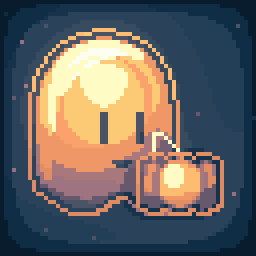</a> <b>Boo</b> <a href="projects/Boo/Boo_122003.pxc">.pxc</a></td>
<td align="center" width="16%"><a href="projects/Morphing%20Gem">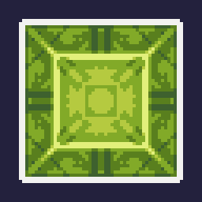</a> <b>Morphing Gem</b> <a href="projects/Morphing%20Gem/Morphing-Gem_122003.pxc">.pxc</a></td>
<td align="center" width="16%"><a href="projects/Sewer">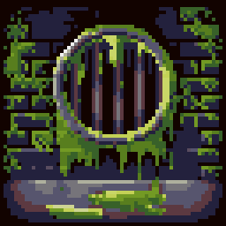</a> <b>Sewer</b> <a href="projects/Sewer/Sewer_122003.pxc">.pxc</a></td>
<td align="center" width="16%"><a href="projects/Ferris%20Wheel%20side">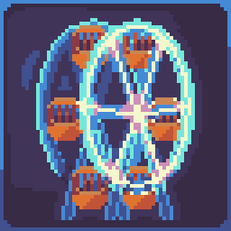</a> <b>Ferris Wheel side</b> <a href="projects/Ferris%20Wheel%20side/Ferris-Wheel-side_122003.pxc">.pxc</a></td>
<td align="center" width="16%"><a href="projects/Jaipur%20Stepwell">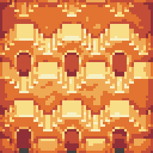</a> <b>Jaipur Stepwell</b> <a href="projects/Jaipur%20Stepwell/Jaipur-Stepwell_122003.pxc">.pxc</a></td>
<td align="center" width="16%"><a href="projects/Underwater%20View">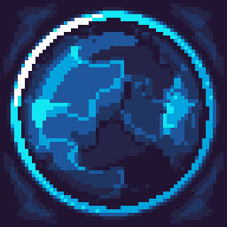</a> <b>Underwater View</b> <a href="projects/Underwater%20View/Underwater-View_122003.pxc">.pxc</a></td>
</tr>
<tr>
<td align="center" width="16%"><a href="projects/Dragon">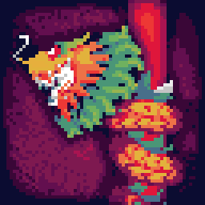</a> <b>Dragon</b> <a href="projects/Dragon/Dragon_122003.pxc">.pxc</a></td>
<td align="center" width="16%"><a href="projects/Old%20Car">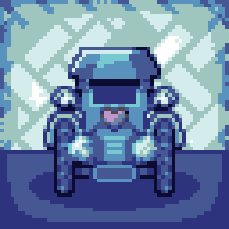</a> <b>Old Car</b> <a href="projects/Old%20Car/Old-Car_122003.pxc">.pxc</a></td>
<td align="center" width="16%"><a href="projects/CDs">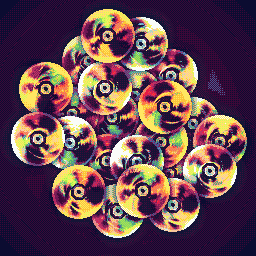</a> <b>CDs</b> <a href="projects/CDs/CDs_122003.pxc">.pxc</a></td>
<td align="center" width="16%"><a href="projects/Vegas">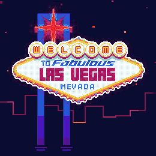</a> <b>Vegas</b> <a href="projects/Vegas/Vegas_122003.pxc">.pxc</a></td>
<td align="center" width="16%"><a href="projects/Night%20Star">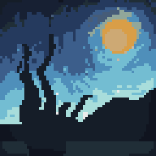</a> <b>Night Star</b> <a href="projects/Night%20Star/Night-Star_122003.pxc">.pxc</a></td>
<td align="center" width="16%"><a href="projects/Abstract%20Hex">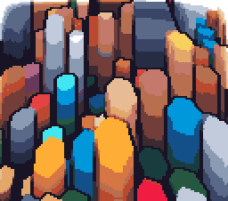</a> <b>Abstract Hex</b> <a href="projects/Abstract%20Hex/Abstract-Hex_122003.pxc">.pxc</a></td>
</tr>
<tr>
<td align="center" width="16%"><a href="projects/Tentacles">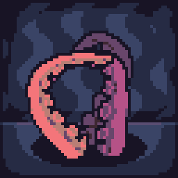</a> <b>Tentacles</b> <a href="projects/Tentacles/Tentacles_122003.pxc">.pxc</a></td>
<td align="center" width="16%"><a href="projects/Chain">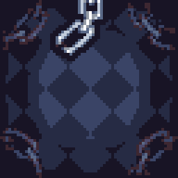</a> <b>Chain</b> <a href="projects/Chain/Chain_122002.pxc">.pxc</a></td>
<td align="center" width="16%"><a href="projects/Hill%20Climb">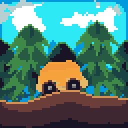</a> <b>Hill Climb</b> <a href="projects/Hill%20Climb/Hill-Climb_122002.pxc">.pxc</a></td>
<td align="center" width="16%"><a href="projects/Barbed%20Wire">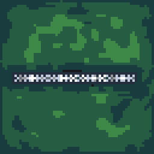</a> <b>Barbed Wire</b> <a href="projects/Barbed%20Wire/Barbed-Wire_122002.pxc">.pxc</a></td>
<td align="center" width="16%"><a href="projects/MPM%20Spaghetti">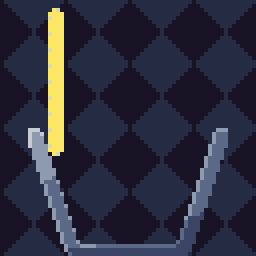</a> <b>MPM Spaghetti</b> <a href="projects/MPM%20Spaghetti/MPM-Spaghetti_122002.pxc">.pxc</a></td>
<td align="center" width="16%"><a href="projects/Top-Down%20Shooter">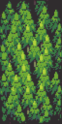</a> <b>Top-Down Shooter</b> <a href="projects/Top-Down%20Shooter/Top-Down-Shooter_121092.pxc">.pxc</a></td>
</tr>
<tr>
<td align="center" width="16%"><a href="projects/Dungeon%20Floor">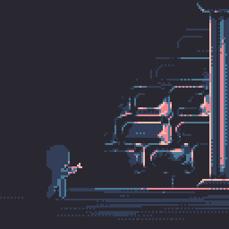</a> <b>Dungeon Floor</b> <a href="projects/Dungeon%20Floor/Dungeon-Floor_121092.pxc">.pxc</a></td>
<td align="center" width="16%"><a href="projects/Portal%20Cream">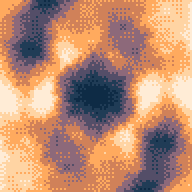</a> <b>Portal Cream</b> <a href="projects/Portal%20Cream/Portal-Cream_121092.pxc">.pxc</a></td>
<td align="center" width="16%"><a href="projects/Fountain">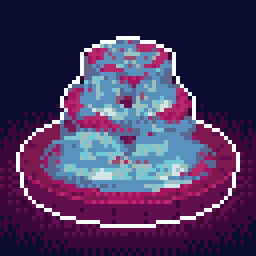</a> <b>Fountain</b> <a href="projects/Fountain/Fountain_121092.pxc">.pxc</a></td>
<td align="center" width="16%"><a href="projects/Crochet%20Flame">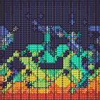</a> <b>Crochet Flame</b> <a href="projects/Crochet%20Flame/Crochet-Flame_121092.pxc">.pxc</a></td>
<td align="center" width="16%"><a href="projects/Lava%20Floor">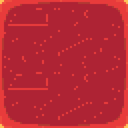</a> <b>Lava Floor</b> <a href="projects/Lava%20Floor/Lava-Floor_121092.pxc">.pxc</a></td>
<td align="center" width="16%"><a href="projects/Rocket%20Thrust">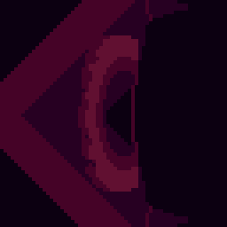</a> <b>Rocket Thrust</b> <a href="projects/Rocket%20Thrust/Rocket-Thrust_121092.pxc">.pxc</a></td>
</tr>
<tr>
<td align="center" width="16%"><a href="projects/Gas%20Station">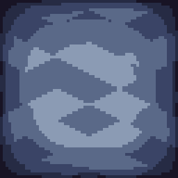</a> <b>Gas Station</b> <a href="projects/Gas%20Station/Gas-Station_121092.pxc">.pxc</a></td>
<td align="center" width="16%"> <b>Ornate Trim</b> <a href="projects/Ornate%20Trim/Ornate-Trim_121092.pxc">.pxc</a></td>
<td align="center" width="16%"><a href="projects/Black%20Hole">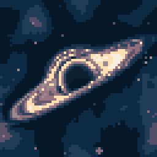</a> <b>Black Hole</b> <a href="projects/Black%20Hole/Black-Hole_121092.pxc">.pxc</a></td>
<td align="center" width="16%"><a href="projects/Aqua%20Shots">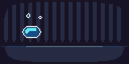</a> <b>Aqua Shots</b> <a href="projects/Aqua%20Shots/Aqua-Shots_121092.pxc">.pxc</a></td>
<td align="center" width="16%"><a href="projects/Spark%20Bolt">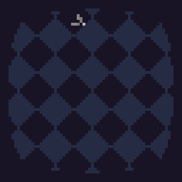</a> <b>Spark Bolt</b> <a href="projects/Spark%20Bolt/Spark-Bolt_121092.pxc">.pxc</a></td>
<td align="center" width="16%"><a href="projects/Icicle">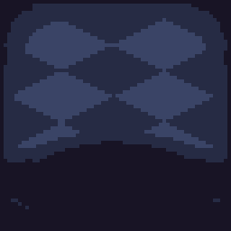</a> <b>Icicle</b> <a href="projects/Icicle/Icicle_121092.pxc">.pxc</a></td>
</tr>
<tr>
<td align="center" width="16%"><a href="projects/Coral%20Reef">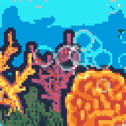</a> <b>Coral Reef</b> <a href="projects/Coral%20Reef/Coral-Reef_121092.pxc">.pxc</a></td>
<td align="center" width="16%"><a href="projects/Fire%20Tornado">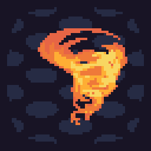</a> <b>Fire Tornado</b> <a href="projects/Fire%20Tornado/Fire-Tornado_121092.pxc">.pxc</a></td>
<td align="center" width="16%"><a href="projects/Glass%20Block%20Refraction">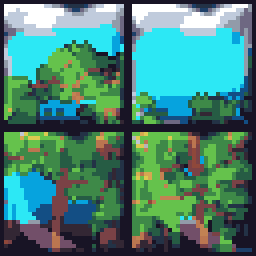</a> <b>Glass Block Refraction</b> <a href="projects/Glass%20Block%20Refraction/Glass-Block-Refraction_121092.pxc">.pxc</a></td>
<td align="center" width="16%"><a href="projects/Cassettes">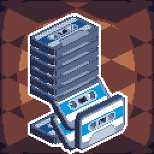</a> <b>Cassettes</b> <a href="projects/Cassettes/Cassettes_121092.pxc">.pxc</a></td>
</tr>
</table>

## Estáticos (94)

<table>
<tr>
<td align="center" width="16%"><a href="projects/Monopteros">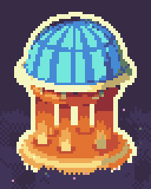</a> <b>Monopteros</b> <a href="projects/Monopteros/Monopteros_122003.pxc">.pxc</a></td>
<td align="center" width="16%"><a href="projects/Parachute">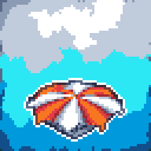</a> <b>Parachute</b> <a href="projects/Parachute/Parachute_122002.pxc">.pxc</a></td>
<td align="center" width="16%"><a href="projects/Cobweb">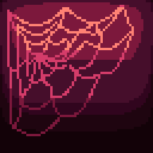</a> <b>Cobweb</b> <a href="projects/Cobweb/Cobweb_121092.pxc">.pxc</a></td>
<td align="center" width="16%"><a href="projects/Rainbow%20Icon">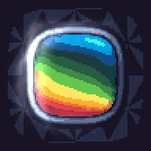</a> <b>Rainbow Icon</b> <a href="projects/Rainbow%20Icon/Rainbow-Icon_121092.pxc">.pxc</a></td>
<td align="center" width="16%"><a href="projects/Film%20Reel">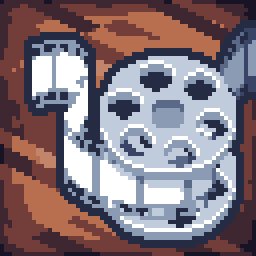</a> <b>Film Reel</b> <a href="projects/Film%20Reel/Film-Reel_121092.pxc">.pxc</a></td>
<td align="center" width="16%"><a href="projects/Typewriter">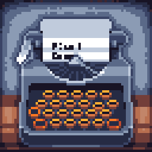</a> <b>Typewriter</b> <a href="projects/Typewriter/Typewriter_121092.pxc">.pxc</a></td>
</tr>
<tr>
<td align="center" width="16%"><a href="projects/Door">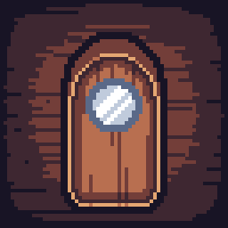</a> <b>Door</b> <a href="projects/Door/Door_121092.pxc">.pxc</a></td>
<td align="center" width="16%"><a href="projects/IsoCubes">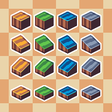</a> <b>IsoCubes</b> <a href="projects/IsoCubes/IsoCubes_121092.pxc">.pxc</a></td>
<td align="center" width="16%"><a href="projects/Iso%20Tower">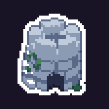</a> <b>Iso Tower</b> <a href="projects/Iso%20Tower/Iso%20Tower_121092.pxc">.pxc</a></td>
<td align="center" width="16%"><a href="projects/Half%20Hearted">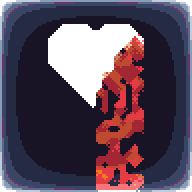</a> <b>Half Hearted</b> <a href="projects/Half%20Hearted/Half%20Hearted_121092.pxc">.pxc</a></td>
<td align="center" width="16%"><a href="projects/Windmill">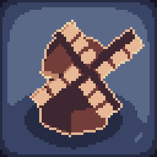</a> <b>Windmill</b> <a href="projects/Windmill/Windmill_121092.pxc">.pxc</a></td>
<td align="center" width="16%"> <b>Scenic Forest</b> <a href="projects/Scenic%20Forest/Scenic%20Forest_121092.pxc">.pxc</a></td>
</tr>
<tr>
<td align="center" width="16%"> <b>Roadway</b> <a href="projects/Roadway/Roadway_121092.pxc">.pxc</a></td>
<td align="center" width="16%"> <b>Art Deco</b> <a href="projects/Art%20Deco/Art%20Deco_121092.pxc">.pxc</a></td>
<td align="center" width="16%"> <b>Dominoes</b> <a href="projects/Dominoes/Dominoes_121092.pxc">.pxc</a></td>
<td align="center" width="16%"> <b>Castle grey 1</b> <a href="projects/Castle%20grey%201/Castle%20grey%201_121092.pxc">.pxc</a></td>
<td align="center" width="16%"> <b>Circuit</b> <a href="projects/Circuit/Circuit_121092.pxc">.pxc</a></td>
<td align="center" width="16%"> <b>Spiral Portal</b> <a href="projects/Spiral%20Portal/Spiral%20Portal_121092.pxc">.pxc</a></td>
</tr>
<tr>
<td align="center" width="16%"> <b>Slash</b> <a href="projects/Slash/Slash_121092.pxc">.pxc</a></td>
<td align="center" width="16%"> <b>Rags</b> <a href="projects/Rags/Rags_121092.pxc">.pxc</a></td>
<td align="center" width="16%"> <b>Skirt</b> <a href="projects/Skirt/Skirt_121092.pxc">.pxc</a></td>
<td align="center" width="16%"> <b>Lillypads</b> <a href="projects/Lillypads/Lillypads_121092.pxc">.pxc</a></td>
<td align="center" width="16%"> <b>Fur Bush</b> <a href="projects/Fur%20Bush/Fur%20Bush_121092.pxc">.pxc</a></td>
<td align="center" width="16%"> <b>Facet</b> <a href="projects/Facet/Facet_121092.pxc">.pxc</a></td>
</tr>
<tr>
<td align="center" width="16%"> <b>Aurora</b> <a href="projects/Aurora/Aurora_121092.pxc">.pxc</a></td>
<td align="center" width="16%"> <b>Layered Hills</b> <a href="projects/Layered%20Hills/Layered%20Hills_121092.pxc">.pxc</a></td>
<td align="center" width="16%"> <b>Spiral Sunset</b> <a href="projects/Spiral%20Sunset/Spiral%20Sunset_121092.pxc">.pxc</a></td>
<td align="center" width="16%"> <b>Cyber Streetview</b> <a href="projects/Cyber%20Streetview/Cyber%20Streetview_121092.pxc">.pxc</a></td>
<td align="center" width="16%"> <b>Red Sphere thing</b> <a href="projects/Red%20Sphere%20thing/Red%20Sphere%20thing_121092.pxc">.pxc</a></td>
<td align="center" width="16%"> <b>Mountain Wave</b> <a href="projects/Mountain%20Wave/Mountain%20Wave_121092.pxc">.pxc</a></td>
</tr>
<tr>
<td align="center" width="16%"> <b>Moon Watching</b> <a href="projects/Moon%20Watching/Moon%20Watching_121092.pxc">.pxc</a></td>
<td align="center" width="16%"> <b>Jellyfish</b> <a href="projects/Jellyfish/Jellyfish_121092.pxc">.pxc</a></td>
<td align="center" width="16%"> <b>Stacked Tower</b> <a href="projects/Stacked%20Tower/Stacked%20Tower_121092.pxc">.pxc</a></td>
<td align="center" width="16%"> <b>Galaxy</b> <a href="projects/Galaxy/Galaxy_121092.pxc">.pxc</a></td>
<td align="center" width="16%"> <b>Fruit Bowl</b> <a href="projects/Fruit%20Bowl/Fruit%20Bowl_121092.pxc">.pxc</a></td>
<td align="center" width="16%"> <b>Tower Badge</b> <a href="projects/Tower%20Badge/Tower%20Badge_121092.pxc">.pxc</a></td>
</tr>
<tr>
<td align="center" width="16%"> <b>Nixie</b> <a href="projects/Nixie/Nixie_121092.pxc">.pxc</a></td>
<td align="center" width="16%"> <b>Flower Frame</b> <a href="projects/Flower%20Frame/Flower%20Frame_121092.pxc">.pxc</a></td>
<td align="center" width="16%"> <b>Flower Bloom</b> <a href="projects/Flower%20Bloom/Flower%20Bloom_121092.pxc">.pxc</a></td>
<td align="center" width="16%"> <b>Ferriswheel</b> <a href="projects/Ferriswheel/Ferriswheel_121092.pxc">.pxc</a></td>
<td align="center" width="16%"> <b>Vertical Buildings</b> <a href="projects/Vertical%20Buildings/Vertical%20Buildings_121092.pxc">.pxc</a></td>
<td align="center" width="16%"> <b>Amphitheatre</b> <a href="projects/Amphitheatre/Amphitheatre_121092.pxc">.pxc</a></td>
</tr>
<tr>
<td align="center" width="16%"> <b>Bicycle</b> <a href="projects/Bicycle/Bicycle_121092.pxc">.pxc</a></td>
<td align="center" width="16%"> <b>Flame Sword Trail</b> <a href="projects/Flame%20Sword%20Trail/Flame%20Sword%20Trail_121092.pxc">.pxc</a></td>
<td align="center" width="16%"> <b>Sword Gen</b> <a href="projects/Sword%20Gen/Sword%20Gen_121092.pxc">.pxc</a></td>
<td align="center" width="16%"> <b>SnowFlake</b> <a href="projects/SnowFlake/SnowFlake_121092.pxc">.pxc</a></td>
<td align="center" width="16%"> <b>Lava Flow</b> <a href="projects/Lava%20Flow/Lava%20Flow_121092.pxc">.pxc</a></td>
<td align="center" width="16%"> <b>Ice</b> <a href="projects/Ice/Ice_121092.pxc">.pxc</a></td>
</tr>
<tr>
<td align="center" width="16%"> <b>Eifel</b> <a href="projects/Eifel/Eifel_121092.pxc">.pxc</a></td>
<td align="center" width="16%"> <b>Disco</b> <a href="projects/Disco/Disco_121092.pxc">.pxc</a></td>
<td align="center" width="16%"> <b>Camera</b> <a href="projects/Camera/Camera_121092.pxc">.pxc</a></td>
<td align="center" width="16%"> <b>Bridge</b> <a href="projects/Bridge/Bridge_121092.pxc">.pxc</a></td>
<td align="center" width="16%"> <b>Shield</b> <a href="projects/Shield/Shield_121092.pxc">.pxc</a></td>
<td align="center" width="16%"> <b>Potions</b> <a href="projects/Potions/Potions_121092.pxc">.pxc</a></td>
</tr>
<tr>
<td align="center" width="16%"> <b>Rusted Iron</b> <a href="projects/Rusted%20Iron/Rusted%20Iron_121092.pxc">.pxc</a></td>
<td align="center" width="16%"> <b>Fruit Randomizer</b> <a href="projects/Fruit%20Randomizer/Fruit%20Randomizer_121092.pxc">.pxc</a></td>
<td align="center" width="16%"> <b>Ice Mage</b> <a href="projects/Ice%20Mage/Ice%20Mage_121092.pxc">.pxc</a></td>
<td align="center" width="16%"> <b>Fire Wand</b> <a href="projects/Fire%20Wand/Fire%20Wand_121092.pxc">.pxc</a></td>
<td align="center" width="16%"> <b>Armor</b> <a href="projects/Armor/Armor_121092.pxc">.pxc</a></td>
<td align="center" width="16%"> <b>Baked Bread</b> <a href="projects/Baked%20Bread/Baked%20Bread_121092.pxc">.pxc</a></td>
</tr>
<tr>
<td align="center" width="16%"> <b>Zen Garden</b> <a href="projects/Zen%20Garden/Zen%20Garden_121092.pxc">.pxc</a></td>
<td align="center" width="16%"> <b>Tram</b> <a href="projects/Tram/Tram_121092.pxc">.pxc</a></td>
<td align="center" width="16%"> <b>3D Maze</b> <a href="projects/3D%20Maze/3D%20Maze_121092.pxc">.pxc</a></td>
<td align="center" width="16%"> <b>Chess Pieces</b> <a href="projects/Chess%20Pieces/Chess%20Pieces_121092.pxc">.pxc</a></td>
<td align="center" width="16%"> <b>Old TV</b> <a href="projects/Old%20TV/Old%20TV_121092.pxc">.pxc</a></td>
<td align="center" width="16%"> <b>Wooden Ship</b> <a href="projects/Wooden%20Ship/Wooden%20Ship_121092.pxc">.pxc</a></td>
</tr>
<tr>
<td align="center" width="16%"> <b>Red Castle</b> <a href="projects/Red%20Castle/Red%20Castle_121092.pxc">.pxc</a></td>
<td align="center" width="16%"> <b>Curtain</b> <a href="projects/Curtain/Curtain_121092.pxc">.pxc</a></td>
<td align="center" width="16%"> <b>Barrel</b> <a href="projects/Barrel/Barrel_121092.pxc">.pxc</a></td>
<td align="center" width="16%"> <b>Stone Wall</b> <a href="projects/Stone%20Wall/Stone%20Wall_121092.pxc">.pxc</a></td>
<td align="center" width="16%"> <b>Broken Vase</b> <a href="projects/Broken%20Vase/Broken%20Vase_121092.pxc">.pxc</a></td>
<td align="center" width="16%"> <b>Cliff Face</b> <a href="projects/Cliff%20Face/Cliff%20Face_121092.pxc">.pxc</a></td>
</tr>
<tr>
<td align="center" width="16%"> <b>Plasma Ball</b> <a href="projects/Plasma%20Ball/Plasma%20Ball_121092.pxc">.pxc</a></td>
<td align="center" width="16%"> <b>Fire & Smoke</b> <a href="projects/Fire%20%26%20Smoke/Fire%20%26%20Smoke_121092.pxc">.pxc</a></td>
<td align="center" width="16%"> <b>Salmon</b> <a href="projects/Salmon/Salmon_121092.pxc">.pxc</a></td>
<td align="center" width="16%"> <b>Healing FX</b> <a href="projects/Healing%20FX/Healing%20FX_121092.pxc">.pxc</a></td>
<td align="center" width="16%"> <b>Butter</b> <a href="projects/Butter/Butter_121092.pxc">.pxc</a></td>
<td align="center" width="16%"> <b>Battery</b> <a href="projects/Battery/Battery_121092.pxc">.pxc</a></td>
</tr>
<tr>
<td align="center" width="16%"> <b>Curved Bamboo</b> <a href="projects/Curved%20Bamboo/Curved%20Bamboo_121092.pxc">.pxc</a></td>
<td align="center" width="16%"> <b>Coffee Stain</b> <a href="projects/Coffee%20Stain/Coffee%20Stain_121092.pxc">.pxc</a></td>
<td align="center" width="16%"> <b>Roller</b> <a href="projects/Roller/Roller_121092.pxc">.pxc</a></td>
<td align="center" width="16%"> <b>Melting Icecream</b> <a href="projects/Melting%20Icecream/Melting%20Icecream_121092.pxc">.pxc</a></td>
<td align="center" width="16%"> <b>Brick Arc</b> <a href="projects/Brick%20Arc/Brick%20Arc_121092.pxc">.pxc</a></td>
<td align="center" width="16%"> <b>Lava Bubble</b> <a href="projects/Lava%20Bubble/Lava%20Bubble_121092.pxc">.pxc</a></td>
</tr>
<tr>
<td align="center" width="16%"> <b>Conveyor Belt</b> <a href="projects/Conveyor%20Belt/Conveyor%20Belt_121092.pxc">.pxc</a></td>
<td align="center" width="16%"> <b>Mushroom Cloud</b> <a href="projects/Mushroom%20Cloud/Mushroom%20Cloud_121092.pxc">.pxc</a></td>
<td align="center" width="16%"> <b>Beer</b> <a href="projects/Beer/Beer_121092.pxc">.pxc</a></td>
<td align="center" width="16%"> <b>Vinyl</b> <a href="projects/Vinyl/Vinyl_121092.pxc">.pxc</a></td>
<td align="center" width="16%"> <b>Toaster</b> <a href="projects/Toaster/Toaster_121092.pxc">.pxc</a></td>
<td align="center" width="16%"> <b>Forest Night</b> <a href="projects/Forest%20Night/Forest%20Night_121092.pxc">.pxc</a></td>
</tr>
<tr>
<td align="center" width="16%"> <b>Sunny Side</b> <a href="projects/Sunny%20Side/Sunny%20Side_121092.pxc">.pxc</a></td>
<td align="center" width="16%"> <b>Slicing Toast</b> <a href="projects/Slicing%20Toast/Slicing%20Toast_121092.pxc">.pxc</a></td>
<td align="center" width="16%"> <b>Wooden Wand</b> <a href="projects/Wooden%20Wand/Wooden%20Wand_121092.pxc">.pxc</a></td>
<td align="center" width="16%"> <b>Watermil</b> <a href="projects/Watermil/Watermil_121092.pxc">.pxc</a></td>
</tr>
</table>

---

Projetos e miniaturas: © MakhamDev, distribuídos gratuitamente em pixel-composer.com, sem licença declarada para os arquivos `.pxc`. O app Pixel Composer é MIT.

Para regenerar `media/`, rode `python3 -I scripts/pxc_previews.py pixel-composer/projects pixel-composer/media pixel-composer/items.json`.
